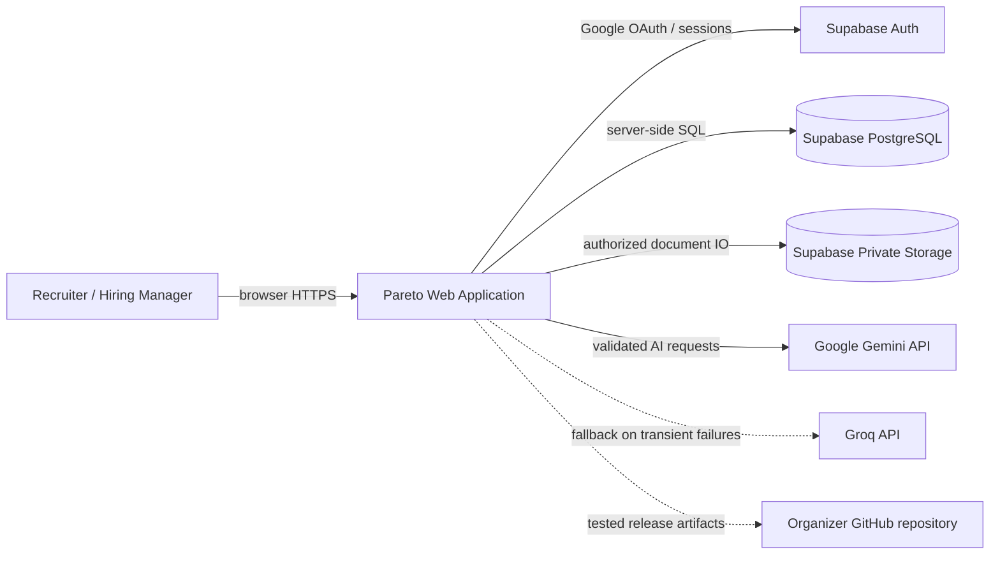
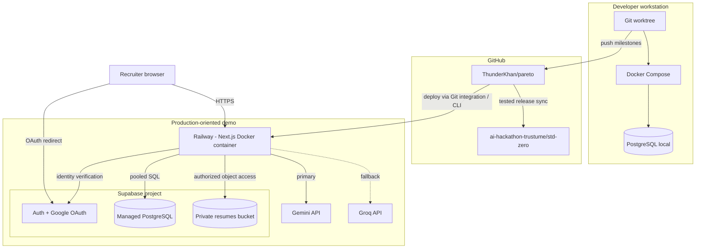
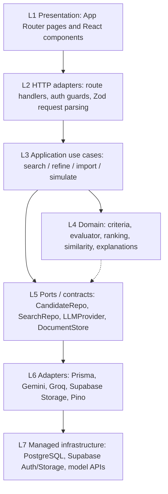
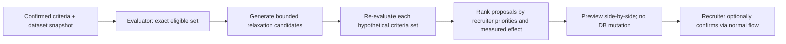
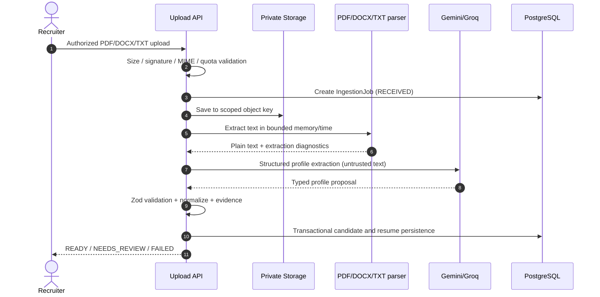
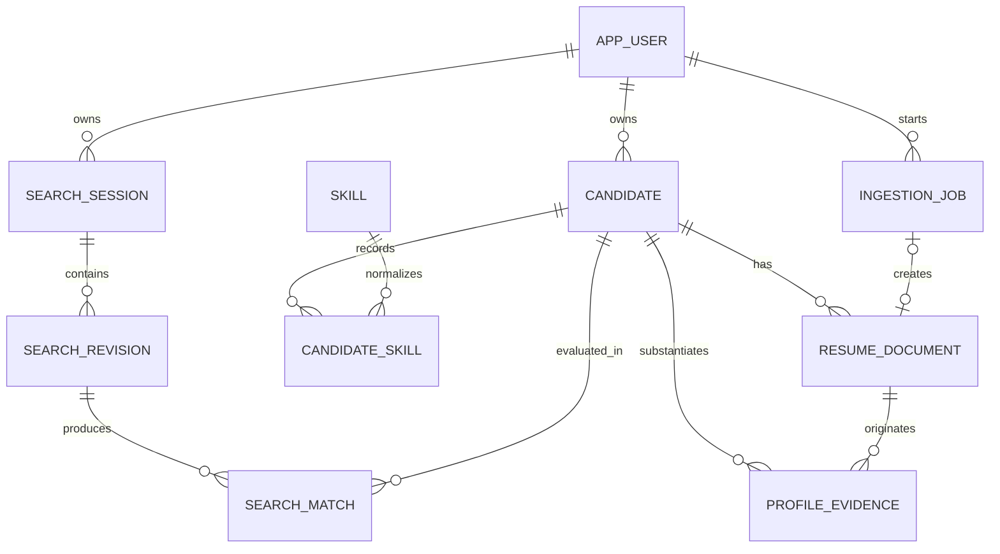
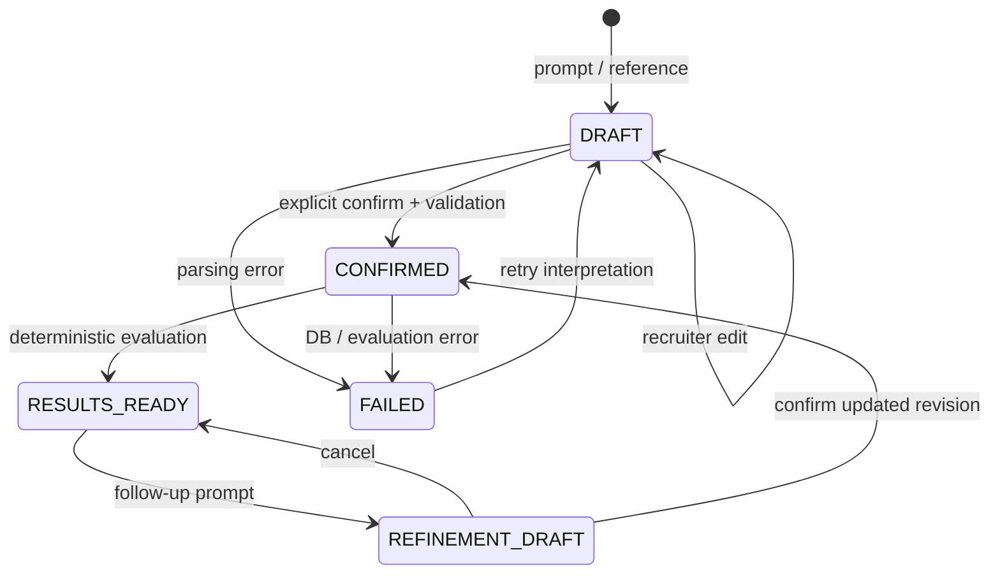
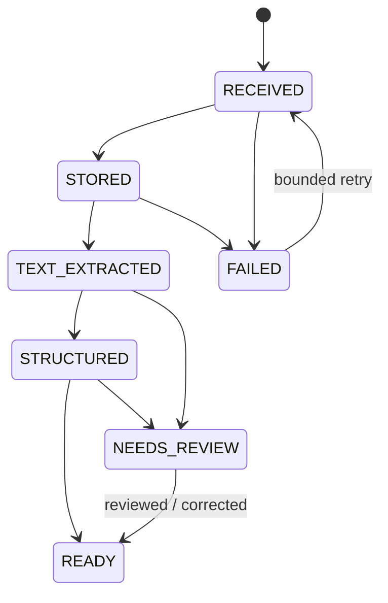
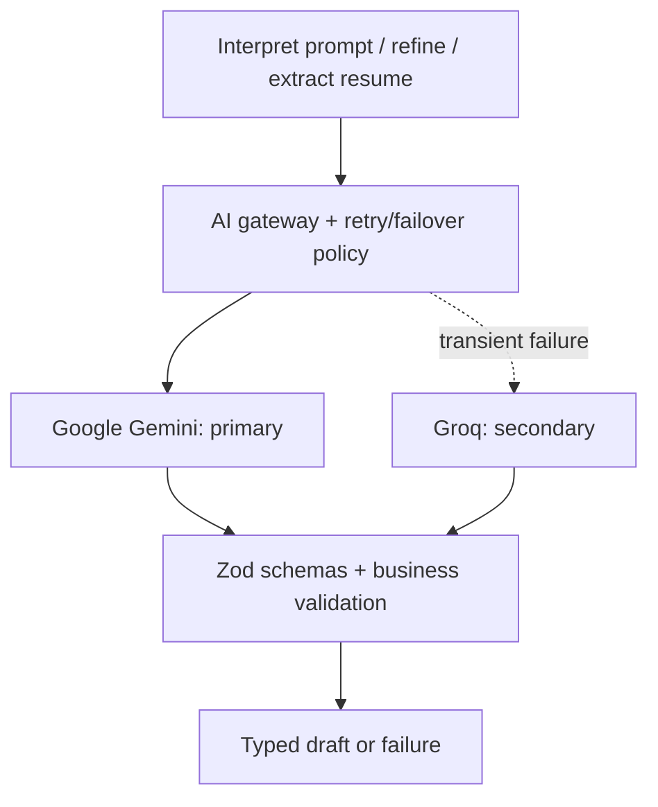
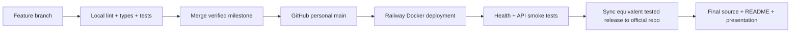

# Pareto — System Architecture

> **Document:** ARCHITECTURE.md  
> **Version:** 1.0 · 14 November 2026 (IST)  
> **Status:** Proposed target architecture, aligned with the existing M0 scaffold; **not** a claim of implementation or deployment  
> **Product:** Pareto — AI-powered, explainable candidate discovery and hiring-constraint analysis  
> **Authoritative requirements:** [PRD.md](PRD.md) (organizer P0 first), [MVP.md](MVP.md)  
> **Repository:** `ThunderKhan/pareto` (development), `ai-hackathon-trustume/std-zero` (official submission)  
> **Code freeze:** 15 November 2026 at 5:00 PM IST

---

## 0. Navigation / quick-reference map

| You need to understand… | Read |
| --- | --- |
| Decisions, principles, and system boundaries | Sections 1–3 |
| C4-style system context, deployment, trust boundaries | Sections 4–5 |
| **Horizontal architectural layers** and dependency rules | Section 6 |
| **Vertical feature slices** and sequence diagrams | Sections 7–8 |
| Domain model, relational data, integrity, indexing | Section 9 |
| API contracts, errors, states, concurrency | Sections 10–11 |
| AI providers, prompts, validation, deterministic ranking | Sections 12–13 |
| Authentication, authorization, privacy, document security | Section 14 |
| Docker, deployment, database operations, CI/CD | Sections 15–16 |
| Observability, reliability, performance, testing | Sections 17–20 |
| Risk register, decisions, reference map, execution gates | Sections 21–24 |

### Normative vocabulary

- **MUST**: necessary to satisfy the architecture's security or correctness guarantees.
- **SHOULD**: strongly recommended for a robust MVP; omission must be justified.
- **MAY**: optional or deferred.
- **P0-ORG**: organizer-mandated PS1 functionality, always taking precedence.
- **P0-FOUNDATION**: minimum data/runtime required for P0-ORG.
- **P1-PRODUCT**: Pareto differentiators and productization.
- **P2-STRETCH**: advanced features only if time permits.
- **Implemented / proposed / deferred** are distinct states. Everything described below is **proposed** unless explicitly identified as already scaffolded.

## 1. Executive architecture decision

**Use a modular monolith with Next.js App Router as the single HTTP/runtime boundary and an internal TypeScript backend package for application/domain/data code.**

- `frontend/` owns React, components, pages, accessibility, rendering and thin Next.js route handlers.
- `backend/` owns business use cases, validation schemas, structured LLM orchestration, candidate retrieval, matching, explanations, and persistence adapters.
- `docs/` owns source-of-truth product requirements, architecture, ADRs, deployment notes, evaluations and the factual engineering log.
- PostgreSQL stores structured candidate, search and evidence records. Supabase hosts PostgreSQL, Auth and a **private** resume object-storage bucket.
- **Only Google Gemini and Groq** are allowed LLM providers. They translate requests and resumes into validated structured proposals. The models **do not decide eligibility or invent result counts**.
- Deterministic TypeScript code calculates eligibility, relevance, similarity, explanations, search bottlenecks and what-if outcomes.
- Docker packages the Next.js application. Docker Compose provisions the local application + development PostgreSQL. Railway is the preferred container host, **pending a real deployment check**.
- Testing uses Vitest and Playwright. GitHub Actions configuration remains manual-only until account credit limits are resolved; local verification is a valid gate.

**Why not microservices?** With one developer and a short hackathon deadline, service discovery, distributed tracing, separate deployments and inter-service authentication would add risk without improving the organizer's scoring criteria. Module boundaries allow future extraction if usage warrants it.

### Design non-negotiables

1. Every organizer PS1 requirement is covered by a real, testable vertical slice.
2. User review and explicit **Confirm Search** separate LLM proposals from executable query state.
3. Database records, not free-form LLM responses, determine candidate facts and results.
4. Search, similarity, explanation, diagnostics and simulation use **one versioned evaluator**.
5. Missing data is **unknown**. Ineligible, unknown and preferred-fit scores are not conflated.
6. Untrusted resumes and prompt text are data, not instructions to override product rules.
7. Authorization is enforced server-side and tested negatively; private documents never become public by default.
8. No fabricated metrics, test reports, incidents or deployment claims.

## 2. Architecture drivers and trade-offs

| Driver | Architectural response | Cost/trade-off |
| --- | --- | --- |
| 40% judging weight on accuracy | Deterministic matching + golden fixtures + typed LLM output | More domain modeling than a simple chatbot |
| 25% on explainability and edge cases | Per-criterion outcomes with stored evidence and explicit unknown states | More precise provenance fields |
| 20% on architecture/code | Modular monolith, clean interfaces, migrations and documentation | Some abstraction upfront |
| 15% on UX/demo | Short confirm→results flow and reliable seed data | Postpone fancy visual effects |
| Unprovided dataset | Synthetic seed set, optional PDF/DOCX ingestion | Must verify license if using third-party datasets |
| 48-hour event / earlier code freeze | Build complete P0 vertical slices before P1 | Limits OCR, advanced search and analytics |
| Multiple model providers | Common schema, bounded failover, provider-independent contracts | Need model-specific smoke checks |
| Free-tier hosting | Small container, small connection pool, no background fleet | Constrained compute and ingestion throughput |
| Two repositories | One Git history with staged, tested milestone synchronization | Need explicit release tracking |
| Sensitive resumes | Private object storage + scoped application data + redacted logs | Additional authorization tests |

## 3. System boundaries and explicit exclusions

**Inside Pareto:** recruiter-facing web UI, HTTP endpoints, search sessions, structured natural-language parsing, criteria confirmation, candidate records, match engine, similarity, explanations, diagnostics, what-if analysis, optional resume ingestion and private document access.

**Managed external dependencies:** Supabase Auth, Supabase PostgreSQL, Supabase Storage, Gemini API, Groq API, Railway deployment environment, GitHub repositories.

**Not part of MVP:** an independent FastAPI/Fastify backend, autonomous hiring decisions, email outreach, interview booking, applicant tracking, candidate portals, CV image/OCR reconstruction, Kafka/Redis, vector infrastructure, dedicated worker infrastructure, microservices, Kubernetes, or custom foundation-model training.

**No forced external data:** core search can run against a reproducible *synthetic* seed dataset. Live PDF upload is a P1 product capability, not an organizer acceptance requirement.

## 4. System context (C4 level 1)



**Boundary note:** The browser may contact Supabase Auth through configured publishable credentials. **Candidate SQL queries, ranking, diagnostics, LLM requests, and privileged document handling stay on the server.** Protected resources cannot rely on client-only checks.

### 4.1 Trust boundaries

| Boundary | Data crosses | Trust rule |
| --- | --- | --- |
| Browser → Next.js | Search prompts, criteria drafts, IDs, uploaded files | Treat as untrusted; validate Zod schemas, authenticate and authorize |
| Next.js → PostgreSQL | Parameterized queries / transactional writes | Least privilege, ownership predicates, transaction-scoped invariants |
| Next.js → Supabase Auth | Cookies, sessions, OAuth authorization codes | Verified identity; do not trust editable client metadata for privileges |
| Next.js → Storage | Original documents, scoped object keys | Private bucket + access policy; never trust client-specified object paths |
| Next.js → Gemini/Groq | Prompt text and selected extracted content | Minimize data; bounded timeouts; sanitize output through schemas |
| Source resume → parser / model | Arbitrary, attacker-controlled content | Treat instructions inside document as data, not agent commands |
| Build → Railway | Container image, runtime variables | Secret injection at deploy time; avoid baking credentials into image |

## 5. Deployment / physical topology (C4 level 2)



**Deployment choice:** One web/container service, managed database and storage; no separate backend HTTP container. API handlers execute in the Next.js **Node.js runtime** because Prisma, file parsers and certain server libraries require Node capabilities. Avoid an Edge runtime default for these routes.

**Local vs cloud:** Compose's database is for development/testing; production points to the managed Supabase database. Migration credentials and service secrets are not checked into Compose or source files. A local authentication mock, if used for isolated tests, must not bypass production authorization.

**Railway contingency:** Its free usage/trial limits and network access must be verified with a real container+Supabase+LLM smoke test. If deployment fails, preserve a reproducible Docker local demo and investigate another compatible host; do not claim a production URL until tested.

## 6. Horizontal architecture — architectural layers

This is **horizontal slicing**: common technical capabilities reused by every user-facing feature. Arrows indicate permitted call direction, not separate network hops.



### 6.1 Responsibilities by layer

| Layer | Owns | MUST NOT own |
| --- | --- | --- |
| **L1 Presentation** | Input forms, draft editor, diff preview, accessibility, result cards, evidence tabs, loading/empty/error states | Database connections, provider keys, business score calculation |
| **L2 HTTP** | JSON/file request parsing, auth session verification, authorization context, request ID, HTTP status/DTO mapping | Candidate ranking decisions or storing raw prompt instructions |
| **L3 Application** | Orchestrate use cases, enforce state transitions, transaction boundaries, provider fallback, result persistence, import lifecycle | Styling, SQL embedded in React, hard-coded model result counts |
| **L4 Domain** | Typed criteria, three-valued matching, eligibility, preferences, similarity, counterfactuals, diagnostic alternatives, source evidence semantics | Network requests or framework/session dependencies |
| **L5 Ports** | Dependency interfaces and input/output contracts | Provider-specific SDK types in domain functions |
| **L6 Adapters** | Prisma repositories, LLM provider SDKs, storage client, JSON logs | Hidden policy changes or AI-based numeric eligibility |
| **L7 Infrastructure** | Auth, SQL, object storage, external inference, deployment host | Product requirements; these remain in code and PRD |

### 6.2 Dependency rule (enforced in code review)

`frontend/src/app/api` may import `@pareto/backend` application functions. A domain module in `backend/src/domain` MUST be framework-independent and import no Next.js, Prisma Client, SDK/provider or filesystem packages. Persistence and AI implementations satisfy **ports**, and test doubles implement the same interfaces.

No React client component imports `@pareto/backend`, Prisma or server-only SDKs. Consider `server-only` boundaries for any server module containing credentials.

### 6.3 Proposed directories (target, not current tree)

```text
pareto/
├── frontend/
│   ├── src/app/
│   │   ├── (auth)/login/
│   │   ├── (app)/search/
│   │   ├── (app)/candidates/
│   │   ├── (app)/import/
│   │   └── api/
│   │       ├── health/
│   │       ├── searches/
│   │       ├── candidates/
│   │       └── imports/
│   ├── src/components/{search,results,candidates,diagnostics,auth,ui}/
│   ├── src/lib/{auth,api}/
│   └── tests/e2e/
├── backend/
│   ├── src/
│   │   ├── domain/{criteria,evaluation,ranking,similarity,diagnostics,evidence}/
│   │   ├── application/{searches,candidates,imports,auth}/
│   │   ├── ports/{candidate-repository,search-repository,llm,object-store}/
│   │   ├── infrastructure/{db,ai,storage,logging}/
│   │   └── contracts/{schemas,dtos}/
│   ├── prisma/{schema.prisma,migrations,seed.ts}
│   └── tests/{unit,integration}/
├── docs/{MVP.md,PRD.md,ARCHITECTURE.md,engineering-log.md,architecture/}
├── .github/workflows/
├── Dockerfile
├── compose.yaml
└── pnpm-workspace.yaml
```

The **current M0 scaffold** only creates the package boundaries, the initial page, a basic health route, Pino helper, and a minimal Prisma Candidate model. It has **not implemented** the proposed domain tree, auth, AI provider adapter, candidate endpoints, full DB model or ingestion pipeline.

## 7. Vertical slicing — feature ownership matrix

This is **vertical slicing**: one feature delivered end-to-end across UI, HTTP, application, domain, storage and tests. Priorities come from the PRD, not from implementation convenience.

| Slice | Priority | UI / route boundary | Application/domain | Persistence & test gate |
| --- | --- | --- | --- | --- |
| **V0** — seeded corpus + core evaluator | P0-FOUNDATION | `/api/health`, internal test harness | CandidateRepo; Criteria; match evaluator | Prisma seed; deterministic fixtures |
| **V1** — natural-language new search | **P0-ORG** ORG-01/02/03 | Search prompt + edit/confirm; `/api/searches/drafts` / `confirm` | InterpretIntent; ConfirmSearch; ExecuteSearch | SearchSession/Revision; E2E prompt→results |
| **V2** — explainable results | **P0-ORG** ORG-04 | Result cards + candidate evidence | EvaluateCriteria; ExplainCandidate | Match evaluations; pass/fail/unknown golden tests |
| **V3** — multi-turn refinement | **P0-ORG** ORG-05 | Chat-like follow-up + change preview | ProposeDelta; MergeCriteria; ConfirmRevision | Immutable revision history; non-destructive tests |
| **V4** — reference-based search | **P0-ORG** ORG-06 | Candidate selection + similarity editor | ExtractReference; CompareProfiles | Same candidates/search tables; exclude-self tests |
| **V5** — search diagnostics | P1-PRODUCT | Diagnostics panel | RelaxAndRecount; IdentifyBottlenecks | Computed counts vs query golden tests |
| **V6** — what-if simulation | P1-PRODUCT | Side-by-side comparison | SimulateCriteria; DiffResults | Read-only operation; no-mutation tests |
| **V7** — resume ingestion | P1-PRODUCT | Import center / upload | ValidateFile; Parse; Normalize; Persist | Private bucket, Resume, IngestionJob; parsing tests |
| **V8** — auth / ownership | P1-PRODUCT, cross-cutting security | Google sign-in, private routes | ResolvePrincipal; AuthorizeResource | Auth identities, row/object ownership; negative tests |
| **V9** — decision-history UI | P2-STRETCH | Search revision timeline | ListRevisions | Read-only projection of stored revisions |

**Vertical-slice delivery rule:** implement a small complete path and test it *before* adding another slice. For example, V1 only counts as finished once draft→edit→confirm→SQL→real results works through the browser, not when the search page looks finished.

## 8. Critical user journeys and sequence diagrams

### 8.1 V1 + V2 — natural-language search, confirmation and explanations

```mermaid
sequenceDiagram
    autonumber
    actor Recruiter
    participant UI as Next.js UI
    participant API as Route handler
    participant AI as Gemini / Groq
    participant S as Search use case
    participant DB as PostgreSQL
    Recruiter->>UI: Enter "Java, Spring Boot, AWS; Hyderabad; ≤30 days"
    UI->>API: POST /api/searches/drafts
    API->>API: Validate input + authorize
    API->>AI: Draft typed criteria (schema-constrained)
    AI-->>API: CandidateSearchCriteria draft
    API-->>UI: Draft and ambiguities (no results yet)
    Recruiter->>UI: Edit criteria, Confirm Search
    UI->>API: POST /api/searches/confirm + revision token
    API->>S: Confirm and execute
    S->>DB: Persist confirmed revision transactionally
    S->>DB: Query candidate records with required facts
    S->>S: Deterministic evaluate + rank + explain
    S-->>API: Confirmed revision + real results
    API-->>UI: Results and criterion breakdowns
```

**Invariant:** LLM output creates a draft, **never an authorized query execution**. A request that skips confirm MUST fail. Search results are computed against persisted, confirmed criteria.

### 8.2 V3 — conversational refinement

```mermaid
sequenceDiagram
    autonumber
    actor Recruiter
    participant UI as Search UI
    participant API as Route handler
    participant AI as Provider gateway
    participant S as Search revision use case
    participant DB as PostgreSQL
    Recruiter->>UI: "Now restrict to joining within 30 days"
    UI->>API: POST /api/searches/{id}/refinements
    API->>DB: Load latest confirmed revision
    API->>AI: Current criteria + follow-up → typed delta
    AI-->>API: { noticePeriodDays: 30 }
    API-->>UI: Proposed diff; unchanged filters preserved
    Recruiter->>UI: Confirm refinement
    UI->>API: POST /api/searches/{id}/confirm (baseVersion)
    API->>S: Validate optimistic version and commit
    S->>DB: Append immutable revision atomically
    S->>S: Re-evaluate corpus
    S-->>UI: New counts and results
```

**State safety:** A `SearchDelta` has separate semantics for **field absent** (preserve), **clear** (explicit removal) and **set** (replacement). Do not use a shallow object merge where `undefined`/`null` can accidentally remove filters. The UI highlights every change for approval.

### 8.3 V4 — “Find Candidates Like Me”

1. Resolve a reference candidate by ID; if only a name is supplied, return matches for disambiguation.
2. Load stored role history, years of experience, skills, industry, location, education and certifications **where known**.
3. Translate documented attributes into editable reference-based criteria; exclude missing fields rather than inventing them.
4. Recruiter confirms; search the **same** CandidateRepo / evaluator with a documented weighted similarity policy.
5. Exclude the reference candidate ID. Show feature-level reasons; allow a normal conversational refinement such as “like this candidate but with AWS.”

**Reference similarity differs from strict eligibility:** the recruiter may designate reference traits as required or preferred, but the UI MUST distinguish these. An opaque 94% “AI similarity” without known math is not acceptable.

### 8.4 V5 + V6 — diagnostics and side-effect-free simulation



**Definition:** For an alternative `A`, `newlyEligible(A) = eligible(A) ∖ eligible(original)`. All before/after counts MUST be derived from the same dataset snapshot/evaluator version. A relaxation must be labeled if it weakens a hard rule. For P1, enumerate bounded single-field relaxations; limited pairwise exploration only when needed. Avoid exhaustive combinatorial search or fabricating counts.

### 8.5 V7 — resume ingestion and provenance



**P1 note:** For 300–500 synthetic candidates, seed via reproducible JSON/CSV first. The upload UI and per-file LLM processing are secondary and may run through a simple bounded server-side job path for the hackathon. For longer-running production ingestion, move work to durable background processing **only if needed**; don't pretend a request-bound process survives container restarts.

## 9. Data architecture and relational model

### 9.1 Source of truth

- **PostgreSQL** owns normalized candidate facts, provenance metadata, confirmed criteria revisions, and result metadata.
- **Private Supabase Storage** owns the original document bytes. Store *object keys*, not permanent public URLs, in SQL.
- **LLM outputs** are temporary proposals or audited extraction results; they are not a source of truth until validated.
- **Search results** are derived from confirmed criteria and a candidate corpus revision; they can be recomputed deterministically.
- **Synthetic seed scripts** are the reproducible source of the demo corpus. Do not commit real applicants' resumes.

### 9.2 Conceptual entity relationship diagram



### 9.3 Proposed tables (implementation contract, not applied migrations)

| Entity | Important fields | Notes/invariants |
| --- | --- | --- |
| `AppUser` | `id` (Supabase Auth UUID), `createdAt` | Backend-owned projection of Auth identity; use auth user ID as principal |
| `Candidate` | `id`, `ownerId`, `displayName`, `roleTitle`, `city`, `country`, `experienceMonths?`, `noticePeriodDays?`, `industry?`, `createdAt`, `updatedAt` | Unknown fact represented as SQL NULL; only needed demo search fields standardized |
| `Skill` | `id`, `canonicalName`, `aliases` (or alias table) | Normalize Java vs JavaScript, AWS vs Amazon Web Services |
| `CandidateSkill` | `candidateId`, `skillId`, `evidenceId?` | Unique pair; distinguish documented from inferred claims if added |
| `ResumeDocument` | `id`, `candidateId`, `ownerId`, `bucket`, `objectKey`, `mime`, `sha256`, `status`, `uploadedAt` | Private object key, no raw file blob in public schema |
| `ProfileEvidence` | `id`, `candidateId`, `resumeId?`, `fieldPath`, `sourceText?`, `pageNumber?`, `confidence?` | Provenance with redaction; confidence is extraction confidence, not candidate suitability |
| `SearchSession` | `id`, `ownerId`, `mode`, `referenceCandidateId?`, `latestVersion`, `createdAt` | Represents conversational context and owner |
| `SearchRevision` | `id`, `searchSessionId`, `version`, `criteriaJson`, `sourcePrompt?`, `status`, `confirmedAt`, `evaluatorVersion` | Immutable confirmed revisions; drafts separate or explicitly status=DRAFT |
| `SearchMatch` | `revisionId`, `candidateId`, `eligibility`, `preferredScore?`, `explanationJson` | Optional bounded result snapshot; enforce revision/candidate uniqueness |
| `IngestionJob` | `id`, `ownerId`, `documentId?`, `state`, `errorCode?`, `attemptCount`, `timestamps` | Recoverable job lifecycle, no raw resume in logs |

**Optional later:** `CandidateRoleHistory`, `Education`, `Certification`, `SearchSimulation`, `AuditEvent`. These can begin as typed JSON for a fast P0 implementation **only if** consistent Zod schemas and evidence references exist. Normalize later when multi-row queries justify it.

### 9.4 Data types, values and invariants

- `experienceMonths`: nullable nonnegative integer. Display in years, but compare numeric min/max without floating-point drift; example 6–10 years maps to inclusive 72–120 months.
- `noticePeriodDays`: nullable nonnegative integer. Requirement `≤30` means **30 is included**. “Immediately” is 0 when explicitly documented.
- `skills`: canonical exact IDs with a controlled alias map; never fuzzy-equate Java and JavaScript.
- `city/country`: normalized, not derived from name or nationality; don't silently conflate Hyderabad and a different city with a similar name.
- `profileEvidence`: source fields can come from seeded records or imported text. If the evidence is not available, mark the field as not independently verified.
- `sourceVersion/datasetVersion`: attach a corpus snapshot identifier or timestamps to evaluations and demo metrics; later imports should not silently rewrite historically reported candidate counts.
- Source documents can have duplicate content hashes; handle with owner-scoped deduplication or explicit "already imported" status.

### 9.5 Persistence and index plan

**P0 indexes:** candidates by owner + role/location; candidate skills by skill and candidate ID; search sessions by owner/time; search revisions unique on (session, version); matches unique on (revision, candidate). Use keyset/cursor pagination or bounded offset for the small demo dataset.

**Search plan for 300–500 profiles:** load a bounded filtered set into a deterministic evaluator, or push simple predicates to SQL and evaluate the residual criteria. **Never** fetch all sensitive candidate profiles without owner scoping. Optimize only after profiling.

**Transactions:** confirming a search creates a new immutable revision and updates `SearchSession.latestVersion` atomically. Use optimistic checks (`expectedVersion`) and return **409 Conflict** if another tab/client has already confirmed a newer revision.

**Storage consistency:** DB and object storage do **not** share an ACID transaction. On upload failure, mark the job failed and schedule explicit object cleanup or retry; an orphan scan/cleanup is preferable to claiming an impossible atomic commit.

**Prisma v7 requirement:** current scaffold includes Prisma v7 and a generator, but **does not yet include the PostgreSQL driver adapter**. The implementation MUST add `@prisma/adapter-pg` and `pg` (with the necessary types) and instantiate Prisma Client using that adapter. Runtime uses the approved pooled connection string; Prisma CLI migrations use the migration-appropriate direct/session URL. Follow the version-matched Prisma v7 docs rather than older URL-in-schema snippets.

## 10. HTTP API surface and contracts

**Convention:** `/api/v1/...`; JSON over HTTPS; thin Next.js Route Handlers that call application use cases. This is a **design contract**, not currently live. All endpoints that access private data require a valid session and ownership check. Use server-generated IDs, Zod validation, bounded pagination and standardized errors.

| Method | Path | Intent | Priority |
| --- | --- | --- | --- |
| GET | `/api/health` | Lightweight liveness; no confidential details | Existing stub |
| GET | `/api/v1/health/ready` | Verify required dependencies, internal/authorized | P0 foundation |
| POST | `/api/v1/searches/drafts` | Prompt → validated criteria draft | **ORG-01** |
| POST | `/api/v1/searches/confirm` | Create confirmed session/revision and evaluate | **ORG-02/03** |
| GET | `/api/v1/searches/:id` | Retrieve confirmed session metadata | **ORG-03** |
| GET | `/api/v1/searches/:id/results` | Paginated ranked results and explanations | **ORG-04** |
| POST | `/api/v1/searches/:id/refinements` | Existing criteria + follow-up → draft delta | **ORG-05** |
| POST | `/api/v1/searches/:id/confirm` | Commit revised criteria with expectedVersion | **ORG-05** |
| GET | `/api/v1/candidates` | Resolve and list reference candidates | **ORG-06** |
| GET | `/api/v1/candidates/:id` | Candidate detail with allowed evidence | **ORG-04/06** |
| POST | `/api/v1/searches/reference-drafts` | Reference ID → editable criteria draft | **ORG-06** |
| GET | `/api/v1/searches/:id/diagnostics` | Computed bottlenecks and suggestions | P1 |
| POST | `/api/v1/searches/:id/simulations` | Preview hypothetical criteria; no mutation | P1 |
| POST | `/api/v1/imports` | Authorized bounded resume upload / register job | P1 |
| GET | `/api/v1/imports/:id` | Import status / extraction errors | P1 |
| GET | `/api/v1/documents/:id/access` | Authorized short-lived source access | P1 |

**Opaque identifiers:** client-visible IDs are scoped to the signed-in owner; ID possession alone grants no access. Resource existence should not be leaked in error text across accounts.

### 10.1 Shared `CandidateSearchCriteria` contract (conceptual)

```json
{
  "role": { "value": "Senior Java Developer", "mode": "required" },
  "location": { "city": "Hyderabad", "mode": "required" },
  "experience": { "minMonths": 72, "maxMonths": 120, "mode": "required" },
  "skills": [
    { "canonical": "Java", "mode": "required" },
    { "canonical": "Spring Boot", "mode": "required" },
    { "canonical": "AWS", "mode": "required" }
  ],
  "noticePeriod": { "maxDays": 30, "mode": "required" },
  "referenceCandidateId": null
}
```

This is a **human-readable contract sketch**, not final generated TypeScript. Optional omitted constraints, null semantics, negative skills and selected reference attributes will be explicitly modeled in Zod before implementation. A robust typed discriminated union is preferable to loosely typed free-form JSON.

### 10.2 Draft response example

```json
{
  "draftId": "draft_01",
  "status": "AWAITING_CONFIRMATION",
  "criteria": {
    "role": { "value": "Java Developer", "mode": "required" },
    "skills": [{ "canonical": "AWS", "mode": "required" }]
  },
  "ambiguities": [],
  "warnings": [],
  "hasExecutedSearch": false
}
```

The draft does not claim candidate counts or a ranked list. **Only confirmation initiates the query.**

### 10.3 Confirmed results — example response shape

```json
{
  "sessionId": "search_01",
  "revision": 1,
  "status": "CONFIRMED",
  "criteria": { "role": { "value": "Java Developer", "mode": "required" } },
  "datasetVersion": "seed-2026-11-14-v1",
  "evaluatorVersion": "rules-v1",
  "counts": { "eligible": 2, "ineligible": 4, "needsReview": 1 },
  "results": [
    {
      "candidateId": "candidate_17",
      "eligibility": "ELIGIBLE",
      "criteriaBreakdown": [
        {
          "criterion": "role",
          "status": "MATCH",
          "evidence": { "field": "currentRole", "value": "Java Developer" }
        }
      ]
    }
  ]
}
```

**Illustration only:** every count and ID above is dummy contract data, not a measured result. The implementation MUST compute counts from stored records.

### 10.4 Error envelope and status mapping

```json
{
  "error": {
    "code": "SEARCH_REVISION_CONFLICT",
    "message": "This search was updated elsewhere. Reload and review the latest criteria.",
    "requestId": "req_abc123",
    "retryable": false
  }
}
```

| HTTP | When | Recovery |
| --- | --- | --- |
| 400 / 422 | Invalid request or malformed criteria | Show field-level errors; don't execute |
| 401 | No verified session | Redirect to login |
| 403 / 404 | Forbidden resource / unavailable scoped resource | No data disclosure |
| 409 | Stale expectedVersion, duplicate confirmation or conflicting state | Reload, compare, reconfirm |
| 413 / 415 | Upload too large / unsupported type | Explain supported size and types |
| 429 | Application or upstream rate limit | Bounded retry / safe backoff |
| 502 / 503 | All LLM providers unavailable or DB dependency down | Retry later; don't invent results |
| 500 | Unexpected internal failure | Log request ID; generic response, no secrets |

**Idempotency:** create/confirm endpoints SHOULD accept an idempotency token scoped to user + intent. Repeating a timed-out confirmation with the same token returns the same committed revision rather than creating duplicates.

## 11. State models and concurrency

### 11.1 Search lifecycle



**Implementation detail:** Represent session and revision status separately. A failed evaluation must not erase the last good confirmed revision. A proposed refinement must not replace the saved confirmed criteria until commit.

### 11.2 Ingestion lifecycle (P1)



**Resume parsing failures** and low-confidence fields are explicitly visible to the user. Don't silently add partially parsed profiles as verified qualified candidates.

### 11.3 Concurrency invariants

- One session has a monotonically increasing integer revision.
- Client confirms with `expectedVersion`; stale confirmations return 409.
- Current active criteria point to exactly one confirmed revision.
- Simulations are **read-only** and cannot update the active revision, candidate record or persisted result count.
- Multi-tab edits remain isolated until explicitly merged/confirmed.
- Use stable deterministic tie-breaking (`candidateId`) after relevance score.
- Support repeatable counts with documented dataset/evaluator version; don't compare incompatible dataset snapshots without labeling the difference.

## 12. LLM provider architecture: Gemini + Groq only



### 12.1 Provider-independent interfaces

- `interpretSearch(prompt, locale?) -> SearchCriteriaDraft`
- `proposeRefinement(confirmedCriteria, followUp) -> CriteriaDelta`
- `extractCandidateProfile(resumeText) -> CandidateExtractionDraft`
- `ProviderAdapter.generateStructured({schema, task, input, timeoutMs}) -> validated object or structured failure`

Use **Vercel AI SDK** as a TypeScript integration layer with direct Gemini/Groq provider adapters. AI SDK does **not** require hosting on Vercel. Model IDs must be verified against actual provider offerings and API-key entitlements; do not hard-code unsupported IDs from memory.

### 12.2 Provider policy

1. Prefer Gemini for the initial search parse.
2. On *transient* failures (timeout, 429 within limits, 5xx), try a bounded Groq fallback.
3. For authentication/key or invalid input errors, return an explicit failure rather than pointless repeated calls.
4. Validate the output against the task-specific Zod schema and domain constraints.
5. Record safe metadata: provider, model, task type, duration, token usage (if available), error category; no raw resume text or full prompts in ordinary logs.
6. Use request deadlines and prevent unbounded model chains. This is a structured extraction pipeline, **not** a multi-agent architecture.
7. If the provider returns semantically unsupported or contradictory requirements, show ambiguity/error; never silently execute.

### 12.3 Prompt-injection / evidence rules

Uploaded resumes and recruiter input are **untrusted user data**. Separate system instructions from source text, cap input sizes, reject tool-like instructions embedded in resumes, and prohibit the model from making storage/query decisions. No model receives database credentials or an ability to execute raw SQL.

**AI outputs may not:** invent notice periods, assert unprovided degrees, generate candidate IDs/counts, write directly to DB, silently relax required criteria, or bypass human confirmation.

## 13. Matching, ranking, explainability, and optimization

### 13.1 Three-valued criterion evaluation

For each candidate `c` and confirmed criterion `r`:

- `MATCH`: the stored value demonstrably satisfies `r`.
- `FAIL`: a known stored value demonstrably violates `r`.
- `UNKNOWN`: evidence is missing/ambiguous/unsupported.

**Hard-constraint aggregation:**
- `INELIGIBLE` if **any** mandatory criterion is `FAIL`.
- `NEEDS_REVIEW` if none fail but **at least one** mandatory criterion is `UNKNOWN`.
- `ELIGIBLE` only if **all** mandatory criteria are `MATCH`.

**Preferred criteria:** influence secondary ranking without changing strict eligibility. Unknown preferred values do not receive free credit.

### 13.2 Ranking design

Separate **eligibility** from **relevance**:

1. Group eligible exact matches first, then needs-review, then explicitly labeled near matches.
2. Within each group, derive preference score from documented weights over known preferred criteria.
3. For reference-based search, use an explainable weighted similarity (e.g. role/skills/experience/industry) calculated from stored facts; show which attributes contribute.
4. Provide stable tie-breaking and score provenance; any displayed percent means **fraction of weighted profile similarity**, **not** probability of job performance.
5. Version the evaluator and weights, so recorded examples remain reproducible.

**Scoring rule must be declared before implementation**, with fixtures that prove missing values and conflicting constraints are handled correctly. Do not treat “5/5 required” as a probability; counts and relevance are distinct outputs.

### 13.3 Explainability contract

Each result includes:
- Effective criterion label and normalized threshold.
- Candidate value (or explicit unknown).
- Outcome (`MATCH`/`FAIL`/`UNKNOWN`).
- Source evidence field or excerpt if available.
- One short reason derived from deterministic rules.
- Eligibility group, optional preferred score, and the versions used.

**Provenance:** When evidence comes from a PDF, preserve relevant excerpt and page if reliably known; when from synthetic structured seed data, cite that record field. Do not invent page numbers.

### 13.4 Diagnostics algorithm (P1)

For confirmed criteria `C` and corpus snapshot `D`:
1. Compute `eligible(C, D)`.
2. Generate a bounded set of permitted relaxations `R1…Rn` (e.g. longer notice period, lower experience floor, required→preferred).
3. Compute `eligible(Ri(C), D)` using the **same evaluator** and data snapshot.
4. Calculate `deltaCount` and `newlyEligibleIds`.
5. Rank suggestions by requested business priorities, size of relaxation and measured gain; explain what is sacrificed.
6. Only *preview* alternatives. Confirmation uses normal search revision state machine.

**Limit:** With many constraints, checking all combinations is exponential. Cap candidate relaxations; P1 single-field first, limited pairwise if specifically useful. Never claim to have solved an unconstrained global optimization problem.

### 13.5 Example deterministic unit test

A seed corpus contains three profiles:
- A: Java, Spring Boot, AWS, Hyderabad, seven years, 15-day notice.
- B: same profile, 60-day notice.
- C: same profile, **unknown** notice.

With the confirmed notice ≤30:
- A → `ELIGIBLE`.
- B → `INELIGIBLE` with explicit notice-period mismatch.
- C → `NEEDS_REVIEW`, **not** eligible or automatically rejected.

If the notice threshold changes to ≤60, B becomes eligible; C remains unknown. This is a **test fixture proposal**, not a measured product result.

## 14. Security architecture, authentication, and privacy

### 14.1 Google OAuth and session lifecycle

1. Browser starts Google sign-in via Supabase Auth.
2. Google redirects through configured Supabase/Next.js OAuth callback.
3. Next.js exchanges/verifies the flow using the version-matched `@supabase/ssr` pattern (PKCE, secure cookie handling).
4. Each protected server request resolves a verified principal; **never trust client-supplied userId as authority**.
5. Resource-level authorization checks owner/workspace access before SQL or Storage operations.
6. Log out/expired session blocks subsequent private operations. Application errors must not silently fall back to broad anonymous access.

Use an allowlist for redirect destinations; no open redirects from `next=` query parameters. OAuth redirect URLs for local and production are configured explicitly.

### 14.2 Prisma ↔ Supabase RLS integration caveat

This requires special care: a **Prisma direct PostgreSQL connection is not automatically the same security context as an authenticated Supabase Data API request**. Its database role and session identity determine whether RLS applies and whether `auth.uid()` is populated. Do not assume normal Supabase policies alone isolate owner records returned through a privileged Prisma connection.

**Chosen MVP stance:**
- Application-domain access via Prisma is **server-only**, authenticated, and explicitly owner-scoped in every repository method.
- Use a **least-privileged database runtime account**, separate from migration/admin credentials. If choosing a role subject to RLS, design/test the correct per-request PostgreSQL auth context rather than assuming JWT propagation.
- Enable RLS on exposed Supabase tables and define **denying-by-default** policies where appropriate; restrict Data API grants if SQL-only access is desired.
- Storage RLS/policies are separate from application-table RLS; verify both.
- Include **negative tests** showing that owner A cannot read owner B's search, candidate, document or results.

**Never** use Supabase `service_role` or secret keys in browser code, and do not use editable `user_metadata` as an authorization source.

### 14.3 Resume security

- Source documents remain in a private bucket. Object keys scoped under authorized owner/import IDs; deny path traversal and cross-user reuse.
- Validate file signature *and* extension/content type; limit size/count/processing time; flag or reject suspicious/damaged files.
- Server authorizes each download. Prefer direct authorized access; if short-lived signed URLs are used, minimize TTL and do not log them. Signed URLs remain usable until expiry, so treat them as sensitive.
- Never check real resumes or proprietary organizer files into a **public** repository.
- Minimize copies of raw resume text. Apply controlled retention and deletion on a per-user basis (details in implementation/spec).
- Candidate ranking MUST NOT use protected traits such as race, religion, sex or age, or infer them from names/photos.

### 14.4 Defensive measures

- HTTP: CSRF defenses for cookie-authenticated writes (Origin validation/SameSite as appropriate), secure cookies, content-type enforcement, upload validation, simple rate limiting.
- Data: parameterized Prisma queries, no interpolated model-generated SQL, schema validation, bounded pagination.
- Models: untrusted document isolation, schema constraints, output review.
- Secrets: environment injection, `.env` excluded from Git, never return provider/API keys.
- Logging: redact PII, headers, tokens, file text and signed URLs.
- Browser: escape candidate text, don't render untrusted model HTML; avoid `dangerouslySetInnerHTML`.
- Availability: timeouts, quotas and errors instead of uncontrolled LLM loops.

## 15. Build, containers, migrations and deployment

### 15.1 Local development

- Node.js 22+ and pnpm workspaces.
- `pnpm dev` runs Next.js.
- `docker compose up --build` is the intended container bootstrap with local PostgreSQL.
- Keep local Postgres data in a named volume; never reuse dev passwords in hosted production.
- Root environment example + workspace examples document variables. Next.js local runtime and Prisma CLI have different env-loading locations; verify both.

### 15.2 Docker image layout

Use a reproducible multi-stage build:
1. Install dependencies from **committed pnpm lockfile** (frozen for stable builds).
2. Generate Prisma Client with pinned dependencies.
3. Build the Next.js standalone output with traced workspace packages.
4. Copy standalone server, public assets, static assets, and required runtime artifacts into a non-root production image.
5. Start with Railway-provided `PORT` and `HOSTNAME=0.0.0.0`; supply runtime secrets only in hosting settings.

**Outstanding M0 gaps:** No `pnpm-lock.yaml` has been committed, Prisma v7 adapter packages are absent, and Docker/Next build has **not** been run. The current starter Dockerfile installs unfrozen dependencies and must be validated before calling the image reproducible. If Prisma generated code is needed during build, add an explicit generation step. These are **implementation tasks**, not assertions that the scaffold already works.

### 15.3 Prisma migration discipline

- Version all schema changes under `backend/prisma/migrations`.
- Development schema iterations use an isolated local database; production migrations use reviewed, deploy-safe files.
- For hosted Supabase, distinguish pooled runtime URL from direct/session migration URL, based on current Prisma v7 + Supabase guidance.
- Do not run `migrate dev` or destructive resets at production startup. Use a controlled `prisma migrate deploy` release step.
- Record schema revision in the engineering log and retain backup/rollback strategies before risky migrations.
- Don't run schema changes concurrently from the developer repo and the organizer repo.

### 15.4 Deployment release flow



The **personal repo** drives development/deployment. The **official organizer repo** must contain tested, integrated code and documentation by code freeze. Maintain a common Git history when permitted; pushing compatible branches or integrating with PRs is preferable to blindly copying files.

**CI caveat:** Because hosted Actions credits are exhausted, include a workflow for future use but rely on locally executed lint, typecheck, unit/integration tests, Docker build and Playwright smoke tests until credits return. Do not mark CI as passed if a job never ran.

## 16. Configuration, environments and secrets

| Variable / secret | Owner | Exposure |
| --- | --- | --- |
| `DATABASE_URL` | Server/runtime | Server only; pooled DB URL if hosted |
| `DIRECT_DATABASE_URL` or `DIRECT_URL` | Migration CLI | Server/deploy only; never in client |
| `NEXT_PUBLIC_SUPABASE_URL` | Client & server | Publishable project URL |
| `NEXT_PUBLIC_SUPABASE_PUBLISHABLE_KEY` | Client & server | Publishable key; must still enforce RLS |
| `SUPABASE_SECRET_KEY` | Authenticated admin adapter if needed | Server only, use sparingly |
| `GOOGLE_GENERATIVE_AI_API_KEY` | AI adapter | Server only |
| `GROQ_API_KEY` | AI adapter | Server only |
| `GEMINI_MODEL`, `GROQ_MODEL` | AI adapter | Server configuration |
| `LOG_LEVEL` | Pino | Server configuration |
| `NODE_ENV`, `PORT` | Container host | Runtime |

**Environment matrix:** local (`.env` / `frontend/.env.local` / `backend/.env`), test (isolated DB and mocked provider adapter), production (Railway-injected secrets + Supabase). Avoid accidental client exposure through a `NEXT_PUBLIC_` prefix on anything secret.

## 17. Observability and diagnostics

### 17.1 Structured logs

Use Pino to emit JSON records for:
- `request_started`, `request_completed`, `request_failed`;
- `search_draft_created`, `search_confirmed`, `search_revision_conflict`;
- `llm_provider_attempt`, `llm_fallback`, `llm_validation_failed`;
- `candidate_search_executed` with safe counts/duration;
- `ingestion_started`, `ingestion_failed`, `ingestion_ready`;
- `simulation_executed` with no personal data.

**Recommended fields:** timestamp, level, event, requestId, route, statusCode, elapsedMs, errorCode, provider/model (when relevant), hashed or opaque session ID when necessary. **Never** log raw prompts, CV text, password, OAuth tokens, DB URLs, secret API keys or signed object URLs.

### 17.2 Metrics and tracing

For the hackathon, record measured:
- Successful/failed intent extraction by provider.
- End-to-end search latency (separate LLM time vs deterministic SQL/ranking).
- Hard-constraint golden-case pass count.
- Refinement regression pass count.
- Explainability consistency failures (target zero).
- Actual Docker build and deployment smoke-test outcomes.

Use manual captured test results, simple structured logs and a runbook. A paid APM/telemetry pipeline is **not** required.

### 17.3 Health endpoints

- `GET /api/health`: liveness, no data leakage; existing scaffolded route returns `status=ok` and `phase=scaffold`.
- `GET /api/v1/health/ready`: protected/limited diagnostic readiness check for essential dependencies, separating DB unavailability from optional provider failure.
- Do not declare the entire product healthy solely because Next.js returns a static landing page.

## 18. Reliability, capacity and performance

**Operating assumptions:** demo corpus ≈300–500 synthetic profiles; a small number of interactive judges/users; no bulk real-time enterprise ingestion. Treat these as planning assumptions, not load-tested claims.

| Risk | Design response |
| --- | --- |
| Slow primary LLM / rate limit | Per-provider deadline + bounded failover to Groq |
| Provider JSON shape inconsistent | Zod + semantic validation; error/clarification |
| DB temporarily unavailable | Retry only safe reads; clear error state and request ID |
| Duplicate user confirm | Idempotency token; optimistic revision check |
| Two concurrent search refinements | Version check; conflict 409 |
| Resume parser hangs | File-size/time limits; bounded resource usage |
| Upload succeeds but DB commit fails | Job status and orphan cleanup |
| Zero exact matches | Honest zero; explain unknowns and optionally run diagnostics |
| Scale exceeds single instance | Profile queries/indexes, optimize; consider worker/service only when justified |
| Railway resources depleted | Docker-based local demo + verified fallback host decision |

**Latency objectives:** No unmeasured SLA is promised. Set initial engineering *budgets* for API calls and timeouts during implementation, instrument them, then report actual percentiles and observed environment. Avoid misleading “sub-second” claims before tests.

## 19. Testing strategy by architectural layer

| Layer | Test type | Representative contract |
| --- | --- | --- |
| Domain | Vitest pure unit tests | Java ≠ JavaScript; 30-day inclusive boundary; 3-valued eligibility |
| Application | Vitest with fake ports | Draft never triggers search; unchanged filters preserved |
| Persistence | Integration with real PostgreSQL | Seeded queries and owner scoping; unique revision/version rules |
| HTTP | Route contract tests | 401/403/409/422 response envelopes; Zod rejects malformed input |
| Auth/storage | Negative integration tests | User A cannot access user B's candidate or document |
| AI adapters | Provider schema smoke tests + mocks | Gemini/Groq output validated; bounded fallback |
| Document parsing | Fixture tests | Text PDF, DOCX, TXT, corrupt/empty/oversize |
| End-to-end | Playwright | Prompt → review/edit → confirm → results → refine → reference search |
| Deployment | Container and live smoke tests | Docker build, health, DB connectivity, one seeded search |

**Organizer P0 gate:** all six PRD ORG-FR-01 through ORG-FR-06 requirements function in a real demo before optional features consume time. Use deterministic fixtures and actual measurements rather than invented “98% accuracy” claims.

## 20. Engineering boundaries and evolution strategy

### 20.1 Why the `backend/` folder exists without its own port

`backend/` is a **package boundary**, not a running process. The HTTP boundary is Next.js route handlers. This keeps frontend/server responsibilities clean while avoiding CORS and duplicated deployments. Future extraction is possible if ingestion or search becomes compute-heavy, at which point the application services can be hosted behind a separate API using the existing port contracts.

### 20.2 What would justify an additional worker or service?

Only after observing one of:
- Resume processing routinely exceeds a request lifetime.
- Many concurrent imports contend for the interactive search pool.
- Independent horizontal scaling is clearly valuable.
- A heavy document AI framework requires Python or GPU libraries.

Until then, explicit bounded, restart-aware ingestion states are enough for P1.

### 20.3 What would justify vector search?

Only if deterministic structured matching performs poorly on realistic domain-language queries and evaluation proves a measurable retrieval improvement. At that point, add embeddings with PostgreSQL `pgvector` and an explainability layer; embeddings must not override explicit hard requirements. A separate vector database is not needed initially.

## 21. Architecture decision record (ADR) register

| ID | Decision | Status | Consequence |
| --- | --- | --- | --- |
| ADR-001 | Modular monolith: Next.js HTTP + internal TS backend package | **Selected** | One deployable service; tight module boundaries |
| ADR-002 | PostgreSQL + Prisma | **Selected** | Schema migrations and typed persistence; Prisma v7 adapter required |
| ADR-003 | Supabase Auth + Google OAuth, private Storage | **Selected for P1** | Must implement RLS/ownership correctly |
| ADR-004 | Gemini primary / Groq fallback; no OpenAI/xAI | **Selected** | Shared schemas and bounded fallback |
| ADR-005 | Deterministic matching; three-valued evidence | **Selected** | Transparent, testable eligibility |
| ADR-006 | Explicit confirmation; append-only revisions | **Selected** | Safe refinements and auditability |
| ADR-007 | Docker + local Compose; Railway preferred | **Selected, unverified** | Deployment proof required |
| ADR-008 | Local verification; GitHub Actions non-blocking | **Selected** | Credit constraint acknowledged |
| ADR-009 | Synthetic corpus first; PDF/DOCX ingestion after core PS1 | **Selected** | Preserve organizer compliance |
| ADR-010 | One evaluator powering search, similarity and diagnostics | **Selected** | Consistent results and explanations |

If a decision changes during implementation, add a dated `docs/architecture/adr-XYZ-*.md` with context, options, trade-offs and verification. Do not silently rewrite the rationale as though there were no earlier decision.

## 22. Risks, unknowns, and reconciliation with the current scaffold

| Risk / gap | Current observation | Required implementation action |
| --- | --- | --- |
| **Repository privacy** | Latest GitHub metadata still says `ThunderKhan/pareto` is **public** | Change to private before adding organizer-provided verbatim files, data, keys |
| Prisma v7 initialization | Existing schema/config present; adapter packages absent | Add and verify `@prisma/adapter-pg` / `pg`, pooled runtime and direct migration config |
| Runtime dependencies | No committed frozen lockfile yet | Install, resolve versions, commit lockfile, run test/build |
| Docker image | Dockerfile + Compose present, not runtime tested | Build/start, inspect standalone paths, use reproducible package install |
| Supabase Auth | SDK dependencies scaffolded; flows absent | Google OAuth callback, cookie session and authorization integration |
| RLS vs Prisma | No verified access model yet | Least-privileged DB role and real cross-owner denial tests |
| LLM adapters | Gemini/Groq not wired yet | Choose supported models, keys, Zod output schemas, provider smoke tests |
| Search schema | Placeholder Candidate table only | Add normalized candidates, skills, search sessions and revisions |
| Dataset | No approved/imported corpus yet | Generate stable seed data; verify any external-source license |
| Ingestion | PDF/DOCX parsing not implemented | Implement only after P0 PS1 works |
| Railway | Hosting not tested and free-tier limited | Deploy early, verify outbound DB/model connectivity |
| Official repository | Separate private organizer repo | Synchronize tested milestones with visible engineering history |

**Critical design warning:** a diagram does not prove these pieces exist. Keep this gap table current and evidence-backed throughout implementation.

## 23. Implementation handoff: recommended sequence

1. **Runtime foundation:** Fix lockfile/Prisma v7 adapter, verify `pnpm check`, Compose build, health endpoint.
2. **Domain-first candidate search:** Finalize typed criteria, seed DB, implement 3-state evaluator and explanation fixtures.
3. **P0 original search vertical slice:** prompt extraction → editable draft → confirm → SQL → explainable results.
4. **P0 conversational refinement:** typed delta, non-destructive merge, revision versioning, conflict tests.
5. **P0 reference-based search:** select example candidate, derive editable attributes, similarity evaluator and exclusion tests.
6. **P1 differentiator:** diagnostics, live what-if comparisons, evidence-backed near matches.
7. **P1 productization:** Google OAuth, private Supabase document ingestion, upload status; never expose real data anonymously.
8. **Release verification:** Docker, Railway, negative auth tests, presentation evidence, official repo sync.

**Schedule adjustment:** Authentication is cross-cutting; implement its minimal boundaries earlier if private data is exposed, but never make a partially configured OAuth system block a synthetic-only organizer demo.

## 24. Reference map and primary documentation

### Internal, authoritative product documents

- [PRD.md](PRD.md) — personas, original organizer functional IDs, user stories and exact acceptance criteria.
- [MVP.md](MVP.md) — product definition, scope and milestone gates.
- [engineering-log.md](engineering-log.md) — factual implementation progress, issues, fixes and verification evidence.
- [architecture/README.md](architecture/README.md) — architecture folder; future ADRs and specialized diagrams.
- **Original organizer PS1 Markdown:** supplied separately; not currently copied into the public development repo. It governs P0 feature requirements.
- **Official Trustume guidelines:** supplied separately; final code freeze, repository deliverables and judging rubric take precedence.

### Current vendor references to verify during implementation

- Next.js standalone output and monorepo tracing: https://nextjs.org/docs/app/api-reference/config/next-config-js/output
- Prisma ORM v7 PostgreSQL adapters and migrations: https://www.prisma.io/docs/orm/v7/core-concepts/supported-databases/postgresql
- Prisma v7 database connections: https://www.prisma.io/docs/orm/v7/prisma-client/setup-and-configuration/databases-connections
- Supabase server-side Auth: https://supabase.com/docs/guides/auth/server-side
- Supabase RLS: https://supabase.com/docs/guides/database/postgres/row-level-security
- Supabase private Storage: https://supabase.com/docs/guides/storage/buckets/fundamentals
- Vercel AI SDK provider catalog: https://ai-sdk.dev/providers/ai-sdk-providers

**Rule for future maintainers:** use this document for system boundaries and responsibility allocation; use PRD for *what must work*; use implementation tasks and tests for *what is actually complete*. Architectural intent must not be confused with verified deployed behavior.
