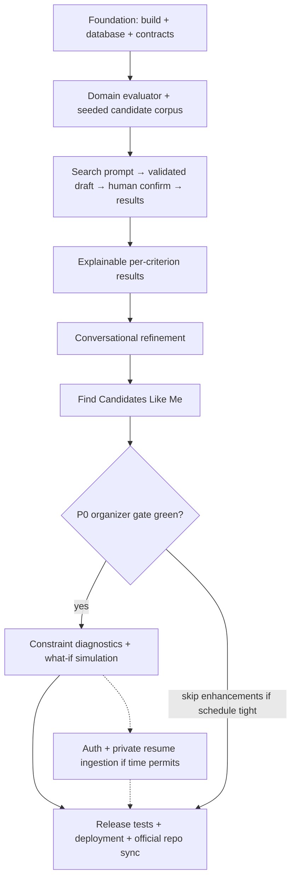

# Pareto — Engineering Implementation Plan

> **Document ID:** PRT-ENG-001  
> **Version:** 1.0 · 14 November 2026 (IST)  
> **Status:** Execution plan — work is **not complete** merely because a task appears here  
> **Project:** Pareto · Trustume AI Hackathon 2026 · Problem Statement 1  
> **Team:** std::zero  
> **Primary repository:** `ThunderKhan/pareto` · **Official submission:** `ai-hackathon-trustume/std-zero`  
> **Official code freeze:** Sunday, **15 November 2026, 5:00 PM IST**  
> **Presentations:** Sunday, **15 November 2026, 6:00–8:00 PM IST**  
> **Requirements authority:** [PRD.md](PRD.md) → [ARCHITECTURE.md](ARCHITECTURE.md) → [DESIGN.md](DESIGN.md) (visual system) → this implementation plan  
> **Working rule:** We can cut our enhancements, but we cannot silently cut the original PS1.

---

## 0. How to use this document

This is the engineering team's **execution playbook**, not a post-hoc success story or a generic list of features. It answers:

- What do we build next, in what order, and why?
- What files and modules will each change touch?
- How do we prove a slice works before moving on?
- What happens when an API, database, deployment, or integration fails?
- How do we keep genuine records of trade-offs, debugging, releases, and lessons?
- How do we deliver the work to the organizers without overwriting their starter repository?

### Document relationships

| Document | Primary responsibility |
| --- | --- |
| [MVP.md](MVP.md) | Product intent, scope, distinctive positioning and release boundary |
| [PRD.md](PRD.md) | Organizer-first functional requirements, personas, acceptance tests |
| [ARCHITECTURE.md](ARCHITECTURE.md) | Technical responsibilities, data/API/state contracts, security and deployment design |
| **IMPLEMENTATION.md** | Ordered work packages, executable tasks, test gates, milestones, rollback and submission |
| [engineering-log.md](engineering-log.md) | **Observed facts**: what was attempted, what happened, what failed, and what changed |

**Source priority:** The original organizer-provided Problem Statement 1 and official event guidelines override anything in this plan. Labels such as **Done**, **Passed**, **Deployed**, and performance figures must be backed by actual evidence.

### Status vocabulary

- `NOT STARTED` — not implemented.
- `IN PROGRESS` — actively being worked on.
- `BLOCKED` — cannot proceed; document the dependency and safe next action.
- `IMPLEMENTED / UNVERIFIED` — code exists but the stated gate was not executed successfully.
- `VERIFIED` — tests or reproducible manual checks were performed with recorded results.
- `DEFERRED` — explicitly cut or postponed, with a reason.
- `RELEASED` — verified release was integrated into the official submission repo.

The **initial statuses below are planning assumptions based on the repository inspection**, not claims of test execution.

---

## 1. Mission, priorities, and irreversible deadlines

### 1.1 Winning strategy

Pareto must deliver the original, complete **AI-Powered Natural Language Candidate Search & “Find Candidates Like Me”** workflow before optional features:

1. Enter a natural-language requirement **or** select a reference candidate.
2. Extract structured search criteria.
3. Let the recruiter edit the proposed criteria.
4. Require explicit **Confirm Search**.
5. Query actual candidate records from a realistic sample database.
6. Explain matches and partial misses **criterion by criterion**.
7. Refine a confirmed search through follow-up conversation without resetting unrelated filters.
8. For reference search, extract known profile attributes, find comparable candidates and explain similarities.

The organizer's acceptance checklist has six items; the eight bullets above unpack its reference-based feature and confirmation sequence. **All are required.**

**Pareto's differentiator:** if the confirmed search is too restrictive, diagnose the bottleneck and show accurate what-if alternatives using the *same evaluator*. This is valuable only after the original six acceptance items work.

### 1.2 Priority classes

| Class | Meaning | Examples | Release policy |
| --- | --- | --- | --- |
| **P0-ORG** | Original PS1 functional requirements | Intent extraction, confirmation, explainability, refinement, reference search | **Hard release blocker** |
| **P0-FOUNDATION** | Minimum runtime/data enabling P0 | Seeded DB, type contracts, functional app, reproducible run | **Hard blocker** |
| **P1-DIFFERENTIATION** | Our unique value proposition | Search diagnostics, what-if simulation, near-match evidence | Implement after P0 |
| **P1-PRODUCTIZATION** | Product-grade extras beyond organizer PS1 | Supabase Google sign-in, resume upload, private document management | Add only without jeopardizing P0 |
| **P2-STRETCH** | Nice-to-have | Full history UI, embeddings, OCR, voice | Cut early if time is constrained |

**Explicit correction:** The organizers did **not** require an uploaded PDF or DOCX to pass PS1; they require a candidate database populated with realistic sample data. The resume-import system is a useful Pareto extension, not a precondition to finishing P0.

### 1.3 Schedule and timeboxing

The published event ends development at **5:00 PM IST on November 15**—not a full 48 hours from the time engineering starts. Use the **actual clock** and avoid pretending there are 48 uninterrupted coding hours.

The table below is a **targeted working schedule**, not a promise or a retrospective statement. Update it with actual times in the engineering log.

| Local checkpoint (IST) | Target outcome | Release decision |
| --- | --- | --- |
| **Sat, Nov 14 — early work block** | Verify local scaffold, install/lock dependencies, initialize DB, establish fixtures | Repair build blockers before UI polish |
| **Sat, Nov 14 — middle block** | Typed criteria, deterministic evaluator and seeded candidates; first full search slice | No fabricated data or scores |
| **Sat, Nov 14 — evening** | All original PS1 paths progressing: extraction, confirmation, explanation, refinements, reference mode | Stop optional work until P0 is viable |
| **Sun, Nov 15 — morning** | Finish P0, run reproducible tests and full browser flow; add one robust differentiator if green | Feature-freeze optional scope at first sign of schedule risk |
| **Sun, Nov 15 — by 1:30 PM** | Deployment/smoke checks, comprehensive README, true engineering evidence | Reserve time for recovery and slides |
| **Sun, Nov 15 — by 3:30 PM** | Presentation rehearsed, official repository integrated and reviewed | Aim to be submission-complete early |
| **Sun, Nov 15 — by 4:30 PM** | Final remote verification and confirmed official main/accepted branch state | Avoid last-minute architectural changes |
| **Sun, Nov 15 — 5:00 PM** | **Hard code freeze** | No unverified last-second release |
| **Sun, Nov 15 — 6:00–8:00 PM** | Live architecture + product demo | Show actual behavior, problems and trade-offs |

**Realistic engineering rule:** Build breaks and third-party delays consume the schedule. Reserve an explicit buffer before 5:00 PM. If behind, reduce P1 scope immediately instead of attempting every feature overnight.

---

## 2. Delivery model: thin vertical slices, stable horizontal contracts

### 2.1 Two views of the same work

**Horizontal foundations** are cross-cutting modules: typed contracts, PostgreSQL, identity, error handling, provider adapters, logging, tests. They should be built only as far as the next feature needs them.

**Vertical slices** are complete user outcomes: search, confirmation, results, explanation, refinement, reference search, diagnostics, uploads. A slice is not done until its UI, API, domain rules, persistence, error states and tests work together.



**Engineering preference:** One working user flow beats six disconnected implementations. The UI and backend can evolve together behind a small stable interface.

### 2.2 Definition of Ready (DoR) for each task

A task is ready to implement when it has:
1. A PRD requirement ID or a concrete technical reason.
2. A specific user behavior or infrastructure outcome.
3. Named code touchpoints and dependencies.
4. At least one success test and one relevant failure/edge test.
5. A timebox and a fallback when external services fail.
6. An explicit acceptance gate that can be verified independently.

### 2.3 Definition of Done (DoD) for each vertical slice

A feature is **VERIFIED** only if:
- The expected behavior works with real/fixture data, not a mock UI result.
- The request and returned objects are Zod validated.
- Required authentication/ownership checks are present for private data.
- Core unit/integration tests pass; one appropriate browser/API smoke check passes.
- Error/empty/loading states exist; no secrets or resume text are printed in logs.
- Implementation artifacts and meaningful trade-offs are committed.
- The engineering log has a factual entry including test commands and results.
- The next person can trace the change back to its PRD requirement.

**Do not mark complete** just because a React page renders, a model returns text, or an endpoint returns 200.

---

## 3. Repository baseline and immediate pre-flight

### 3.1 Known state at the time this plan was written

The GitHub repository already contains:
- A `pnpm` monorepo with `frontend/` (Next.js App Router) and `backend/` (internal TypeScript package).
- A minimal landing page and `/api/health` returning scaffold status.
- Basic Pino logging, a minimal `Candidate` Prisma model, initial Vitest/Playwright files.
- `Dockerfile`, `compose.yaml` and a **manual-only** GitHub Actions workflow.
- The MVP, PRD and architecture documents.

**Not verified:** package install, lockfile, Prisma client generation, migrations, Docker build/run, LLM calls, browser flows, deployment, candidate corpus, Supabase Auth and storage.

**Security issue:** GitHub metadata last reported `ThunderKhan/pareto` as **public**. Change visibility to **private** before importing proprietary organizer files, confidential information, or private resume data. Never add API keys to Git even after making the repository private.

### 3.2 Work package F-001 — local environment and dependency baseline

**Priority:** P0-FOUNDATION · **Blocked by:** local prerequisites only  
**Touched:** root package files, `frontend/package.json`, `backend/package.json`, lockfile, build config.

- [ ] Verify Node.js 22.18+ and pnpm 10.x installed; record actual versions.
- [ ] Clone the personal repo, inspect `git status` and current HEAD, and check `git remote -v`.
- [ ] Run `corepack enable` and `pnpm install`; resolve dependency/version conflicts rather than assuming the scaffold builds.
- [ ] Commit `pnpm-lock.yaml` and use frozen lockfile installs in Docker and any CI.
- [ ] Verify workspace imports, Next.js standalone build, TypeScript settings and the executable health endpoint.
- [ ] Verify Tailwind, shadcn config and Phosphor package wiring; do not spend time designing a full UI yet.
- [ ] Record exact commands, versions and any installation failure/repair in the log.

**Gate:** `pnpm lint`, `pnpm typecheck`, `pnpm test`, and `pnpm build` complete successfully, or any failure is accurately documented with a clear blocker.

**Command baseline:**

```bash
node --version
corepack enable
pnpm --version
pnpm install
pnpm lint
pnpm typecheck
pnpm test
pnpm build
```

### 3.3 Work package F-002 — PostgreSQL / Prisma integration

**Priority:** P0-FOUNDATION · **Blocked by:** F-001  
**Touched:** `backend/prisma/`, DB adapter, seed script, Compose environment.

- [ ] Verify the **installed Prisma v7** version and its current PostgreSQL adapter API.
- [ ] Add appropriate `@prisma/adapter-pg` and `pg` dependencies (with types as needed) and instantiate the generated Prisma Client correctly.
- [ ] Keep a least-privileged runtime DB connection and a separate migration-capable connection in production; use local credentials only in the development environment.
- [ ] Establish schema migration workflow; do **not** run destructive development migrations against Supabase production.
- [ ] Bring up local PostgreSQL with Compose and apply the first actual migration.
- [ ] Query and write a dummy candidate through the **same backend repository interface** the application will use.
- [ ] Implement `/api/v1/health/ready` if necessary, without leaking connection details.
- [ ] Document first-migration and rollback procedure.

**Gate:** real database read/write and migration operations work in an isolated local database; Prisma generated code passes typecheck.

### 3.4 Work package F-003 — one reproducible run command

**Priority:** P0-FOUNDATION · **Blocked by:** F-001 + F-002  
**Touched:** `Dockerfile`, `compose.yaml`, README, environment examples.

- [ ] Fix Docker dependency install to use the committed lockfile.
- [ ] Run Prisma client generation explicitly where needed.
- [ ] Verify Next.js standalone output works with traced internal backend package.
- [ ] Run `docker compose up --build` and confirm the web container can connect to Postgres.
- [ ] Ensure secrets come from local/hosted environment; don't bake them into images or commit real `.env` files.
- [ ] Check container shutdown and persistent database volume.
- [ ] Keep a non-container `pnpm dev` route for rapid debugging.

**Gate:** from a clean checkout, documented steps start the app and health endpoint without manual source edits.

### 3.5 Work package F-004 — baseline security and HTTP contract

**Priority:** P0-FOUNDATION · **Blocked by:** F-001  
**Touched:** `frontend/src/app/api`, `backend/src/contracts`, error helpers, logging.

- [ ] Define centralized Zod validation for input, output and persisted criteria.
- [ ] Standardize `4xx/5xx` error response format, request IDs, bounded pagination and safe error messages.
- [ ] Ensure server-only code is not imported into client components.
- [ ] Implement Pino logging with redaction; disable raw resume/prompt or token logging.
- [ ] Add simple limiters/quotas for LLM-driven endpoints; do not create unbounded retry loops.
- [ ] Establish API request schema/unit tests.

**Gate:** invalid/malformed input is rejected; error envelopes are stable; no key or personal-data leakage.

---

## 4. Candidate model and evaluator — build domain correctness first

### 4.1 Work package D-101 — normalized search criteria contract

**Priority:** P0-FOUNDATION · **Blocked by:** F-001  
**Touched:** `backend/src/domain/criteria`, `backend/src/contracts`.

- [ ] Define `CandidateSearchCriteria` with role, normalized location, inclusive experience bounds in **months**, skills, notice-period days, and optional fields when supported.
- [ ] Distinguish **required** vs **preferred** filters.
- [ ] Distinguish **absent**, **set** and **explicit removal** in refinement operations.
- [ ] Reject negative experience/notice values and inverted ranges.
- [ ] Define a controlled skill alias map; **Java != JavaScript**.
- [ ] Define schema versions for structured LLM output and search revision payloads.
- [ ] Keep all contracts independent of React and Prisma.

**Gate:** schema tests for invalid ranges, unknown fields, dates/boundaries and negation scenarios.

### 4.2 Work package D-102 — candidate corpus and persistence

**Priority:** P0-FOUNDATION · **Blocked by:** F-002, D-101  
**Touched:** Prisma tables/migrations, `backend/prisma/seed.ts`, fixture files.

- [ ] Implement the **minimum useful** Candidate, Skill, CandidateSkill, SearchSession and SearchRevision entities; don't normalize every resume field before it is queried.
- [ ] Include roles/current title, selected previous roles, skills, experience, industry, location, education/certifications and nullable notice period for reference search.
- [ ] Generate **synthetic records only**, deterministically, with a fixed random seed and corpus version.
- [ ] Seed a **small curated set first** (around 30–50 hand-checkable records), with controlled exact matches, near matches, unknowns and conflicting skills.
- [ ] Expand to approximately 150–500 profiles **only after** the evaluator and query behavior are correct.
- [ ] Provide an idempotent seed/reset command for development/test environments only; never drop a production database without safeguards.
- [ ] Document the origin/license if any third-party resume dataset is used. External PDF files are **not required** for P0.
- [ ] Index owner/role/location/skill and search revision lookup paths at a sensible level for the corpus.

**Gate:** seeded data can be queried through application repository ports; counts are reproducible; three known candidates satisfy the expected fixture outcomes.

### 4.3 Work package D-103 — deterministic tri-state evaluator

**Priority:** P0-ORG supporting ORG-FR-03/04 · **Blocked by:** D-101 + D-102  
**Touched:** `backend/src/domain/evaluation` and tests.

For each confirmed required criterion, evaluate:
- `MATCH` when a known candidate value satisfies it.
- `FAIL` when a known value violates it.
- `UNKNOWN` when the attribute is not present or not safely interpretable.

Aggregate to:
- `INELIGIBLE` if any mandatory criterion fails.
- `NEEDS_REVIEW` if none fail and at least one mandatory criterion is unknown.
- `ELIGIBLE` only if every mandatory criterion matches.

**Work checklist:**
- [ ] Implement pure evaluation functions with no DB or model dependency.
- [ ] Model skills with canonical IDs and explicit containment rules.
- [ ] Ensure notice period ≤30 includes **30**, but excludes 31.
- [ ] Handle 0-day/immediate joining, null notice and inconsistent duration units.
- [ ] Separate required-criteria counts from preference scores.
- [ ] Add deterministic ranking/tie-breaking based on documented weights.
- [ ] Return data for criterion-by-criterion explanations (not just a float).
- [ ] Include a rule/evaluator version in result metadata.

**Gate:** the golden fixture produces correct exact, near and unknown eligibility; no user-supplied prompt or LLM response changes the evaluator rules.

### 4.4 Work package D-104 — explanation and evidence mapper

**Priority:** **P0-ORG / ORG-FR-04** · **Blocked by:** D-103  
**Touched:** `backend/src/domain/evidence`, result DTOs, test fixtures.

- [ ] Produce for every criterion: label, requested value, actual stored value if known, outcome and short reason.
- [ ] Attach field provenance from seed data or a parsed source excerpt when available.
- [ ] Produce honest aggregate summaries (e.g. required criteria met vs tested), with a consistent denominator.
- [ ] Do not present an arbitrary percentage as “probability of hiring success.”
- [ ] Keep unknown evidence distinct from a negative match; do not invent PDF page numbers.
- [ ] Ensure detailed breakdown and summary never disagree.

**Gate:** the Java/Hyderabad/notice fixture explains 15-day as match, 60-day as mismatch, null as unknown, exactly as the evaluator does.

---

## 5. Organizer feature delivery — P0-ORG work packages

### 5.1 Slice S-201 — language interpretation: ORG-FR-01

**Outcome:** Recruiter describes a role in English and receives a **draft, editable** typed search object—not a fabricated candidate list.

**Dependencies:** F-004, D-101, provider credentials configured.

**Touches:** `backend/src/application/searches`, `backend/src/infrastructure/ai`, `frontend/src/app/api/v1/searches/drafts`, search UI.

**Work:**
- [ ] Create an `LLMProvider` port and two adapters: **Gemini primary, Groq secondary**. No OpenAI or xAI.
- [ ] Use provider-supported structured output and validate the result with Zod; check domain validity again.
- [ ] Implement `interpretSearch` with a compact prompt that explicitly forbids fabricating omitted requirements.
- [ ] Verify actual model IDs and quotas using both API keys; record actual provider behavior.
- [ ] Implement bounded timeout and fallback for transient failures; reject malformed outputs safely.
- [ ] Build the input form, processing state, editable criteria preview and error state.
- [ ] Store/provide draft identifiers; **do not query candidates** at this stage.

**Acceptance demonstrations:**
- Java + Spring Boot + AWS + Hyderabad + 6–10 years + ≤30-day joining correctly populate separate fields.
- A request with “Java, not JavaScript” doesn't silently require JavaScript.
- Missing notice period remains absent.
- Invalid provider response causes an understandable error rather than a search.

**Exit:** generated criteria are editable, validated, and clearly marked **UNCONFIRMED**.

### 5.2 Slice S-202 — human confirmation and real retrieval: ORG-FR-02/03

**Outcome:** Only explicitly approved criteria are executed against PostgreSQL.

**Dependencies:** S-201, D-102, D-103, D-104.

**Touches:** criteria editor, `/api/v1/searches/confirm`, application use case, Prisma SearchSession/SearchRevision.

**Work:**
- [ ] Validate edits client-side for guidance and server-side for correctness.
- [ ] Expose a clearly labeled **Confirm Search** action.
- [ ] Make each confirmed search its own versioned revision, storing effective criteria.
- [ ] Execute against stored candidates using owner-scoped repository functions.
- [ ] Return real counts: eligible, ineligible and needs review; paginate or bound results.
- [ ] Add clear loading, zero-result and database-error behavior.
- [ ] Prevent duplicate confirms from producing duplicate revisions; use an idempotency key or equivalent.
- [ ] Keep status `DRAFT` vs `CONFIRMED` explicit at UI and API boundaries.

**Acceptance demonstrations:**
- A user edits notice 30→45 and confirms; SQL uses 45.
- Results are based on seeded candidate rows, not model-generated names/counts.
- No search is labeled executed before confirmation.
- A refresh does not silently discard the latest confirmed search.

**Exit:** **one complete golden path**, browser→prompt→draft→edit→confirm→stored results, is verifiably working.

### 5.3 Slice S-203 — explainable result cards: ORG-FR-04

**Outcome:** Every result can defend its match assessment criterion-by-criterion.

**Dependencies:** S-202 + D-104.

**Touches:** result DTO, `frontend/src/components/results`, candidate detail.

**Work:**
- [ ] Show required matches, failures and unknown fields individually.
- [ ] Distinguish exact eligible from partial/near and needs-review candidates in both labels and sorting.
- [ ] Show short evidence-based reasons for role, skills, experience, location and joining.
- [ ] Show provenance (stored field or verified resume excerpt) where available.
- [ ] Keep score weighting documented and independent of LLM-generated narrative.
- [ ] Test content overflow and usable mobile/desktop layouts without adding unrelated pages.

**Exit:** a judge can open one near-match candidate, inspect the real reason, and verify it against the seeded record.

### 5.4 Slice S-204 — conversational refinement: ORG-FR-05

**Outcome:** Follow-up instructions modify an active search without erasing unrelated constraints.

**Dependencies:** S-202; same AI adapter and criteria contract.

**Touches:** `proposeRefinement`, `SearchDelta`, revision API, follow-up input.

**Work:**
- [ ] Load the current **confirmed** criteria and conversational context.
- [ ] Send current state + follow-up to Gemini/Groq for a typed **delta**, not a replacement object.
- [ ] Explicitly represent unchanged, set and clear operations.
- [ ] Show a diff: added / changed / removed requirements.
- [ ] Require confirmation before appending a revision and recomputing results.
- [ ] Use `expectedVersion` and return 409 for a stale tab.
- [ ] Preserve all unaffected role/location/experience/skill restrictions.
- [ ] Keep a recoverable conversational transcript or revision record sufficient for the next turn.

**Acceptance demonstration:** Initial Java + ≥5 years + Hyderabad → add Spring Boot & AWS → add ≤30-day notice. After each confirmation, all unrelated previous constraints remain.

**Exit:** at least **three sequential turns** are demonstrated end-to-end with correct counts and persisted state.

### 5.5 Slice S-205 — reference-candidate search: ORG-FR-06

**Outcome:** Selecting a known reference profile produces an editable similarity search, ranked peers and explainable reasons.

**Dependencies:** D-102/103/104, S-202; reuse S-204 for follow-ups.

**Touches:** reference lookup/list, `reference-drafts` API, candidate selection UI, similarity use case.

**Work:**
- [ ] Search/select an existing reference candidate by ID; if names collide, show a disambiguation list.
- [ ] Read current and past roles, experience, known skills, industry, location, education and certifications **when stored**.
- [ ] Convert reference attributes into recruiter-editable draft criteria.
- [ ] Confirm before execution, exactly as in natural-language mode.
- [ ] Exclude the reference candidate itself from results.
- [ ] Implement an explainable similarity function with declared weights; display feature-level contribution.
- [ ] Preserve reference search context when recruiter says “like this candidate but with AWS.”
- [ ] Show unknown/not-stored reference attributes rather than filling them with guesses.

**Acceptance demonstration:** Pick reference record A → review profile-derived criteria → confirm → display comparable records excluding A with reasons → refine with AWS and reconfirm.

**Exit:** all original problem statement functional areas A–D and all six checklist items can be shown live.

### 5.6 P0 organizer-compliance gate (do not waive)

| Requirement | Evidence required to mark **VERIFIED** |
| --- | --- |
| ORG-FR-01 | Real natural-language prompt produces typed, correct draft |
| ORG-FR-02 | Edit and **Confirm Search** gate controls execution |
| ORG-FR-03 | Real candidate records are queried; exact counts are honest |
| ORG-FR-04 | Per-criterion evidence and mismatch explanations reflect stored facts |
| ORG-FR-05 | Multi-turn follow-up preserves unchanged criteria |
| ORG-FR-06 | Reference candidate search works, excludes self, and remains refinable |

**Stop condition:** If any of these rows is red, do not spend time on optional onboarding illustrations, animations, bulk upload UI, OCR or multi-agent orchestration. Fix the organizer path first.

---

## 6. Differentiation: after the organizer gate

### 6.1 Slice P-301 — Search Health Diagnostics

**Priority:** P1-DIFFERENTIATION  
**Outcome:** Explain why a search returns no/few exact candidates using actual re-evaluation, not model text.

- [ ] Accept confirmed criteria and a known corpus/evaluator version.
- [ ] Enumerate a **bounded** list of single-constraint relaxations: raise joining threshold, lower experience minimum, make one skill preferred, broaden location only when recruiter allows.
- [ ] Re-run the same evaluator for each alternative against the same dataset snapshot.
- [ ] Return original count, alternative count, newly eligible candidate IDs and precisely what changed.
- [ ] Sort by minimal alteration / recruiter priorities / measured candidate-pool gain.
- [ ] Show an explicit warning when a mandatory requirement would be weakened.
- [ ] Validate counts against brute-force fixture calculations.

**Exit:** A zero-result example produces a correct explanation and at least one verified, feasible alternative **if the dataset genuinely supports one**.

### 6.2 Slice P-302 — What-If Hiring Simulator

**Priority:** P1-DIFFERENTIATION · **Dependency:** P-301.

- [ ] Preview original vs proposed criteria, exact-match counts and newly eligible profiles side by side.
- [ ] Do not alter current confirmed revision during simulation.
- [ ] Provide **Apply for review**, not “silently apply.” Return to the normal editable confirmation flow.
- [ ] Test that canceling the proposed change leaves search history and active results unchanged.
- [ ] Reuse deterministic explanations for newly eligible candidate cards.

**Exit:** a reviewer can change a constraint, see mathematically correct differences, cancel or explicitly confirm, and verify no unauthorized state change occurred.

### 6.3 Slice P-303 — counterfactual candidate explanations

**Priority:** P1-DIFFERENTIATION · **Dependency:** D-104 + P-301.

- [ ] On a near-match candidate show the smallest relevant change that could satisfy *known* failed conditions.
- [ ] Never suggest made-up candidate availability for unknown data.
- [ ] Make evidence and the exact rule visible.
- [ ] Reuse existing explanation calculation; don't introduce another LLM-driven scoring system.

**Cut strategy:** P-303 can be represented within the diagnostics/result cards; a dedicated complex panel is not essential.

---

## 7. Productization: selective, security-first scope

### 7.1 Slice P-401 — Supabase authentication + Google OAuth

**Priority:** P1-PRODUCTIZATION (unless any private data is exposed, in which case it becomes a security blocker).

- [ ] Configure a Supabase project, Google OAuth credentials, approved redirect URLs and email/password policy.
- [ ] Implement login, OAuth callback, sign-out and server-side session verification with `@supabase/ssr` using current documentation.
- [ ] Enforce authorization at resource access points, including all Prisma queries and Storage operations.
- [ ] Keep user IDs derived from verified session, never from client parameters.
- [ ] RLS on exposed Supabase tables, least-privileged runtime DB role, separate migration role, private bucket rules.
- [ ] Explicitly test cross-user **403/404** denial for candidate, search, import and document IDs.
- [ ] Reject service-role credentials in client bundles and remove sensitive data from logs.

**Hackathon trade-off:** If OAuth setup threatens P0 completion, demonstrate **synthetic-only data** without private upload functionality. Do not weaken real-document access controls to make login seem finished.

### 7.2 Slice P-402 — private resume ingestion

**Priority:** P1-PRODUCTIZATION · **Requires:** P-401 before users can upload real/private documents.

- [ ] Define upload limits (bytes, count, concurrency) and validate filename, MIME and actual file signatures.
- [ ] Text-based PDF with `pdf-parse`, DOCX with `mammoth`, TXT with bounded decode.
- [ ] Detect scanned/empty PDF content and mark `NEEDS_REVIEW`; defer OCR.
- [ ] Save original source to a **private** Supabase Storage bucket with owner-scoped object key.
- [ ] Track `IngestionJob` states: RECEIVED→STORED→TEXT_EXTRACTED→STRUCTURED→READY, plus FAILED/NEEDS_REVIEW.
- [ ] Use Gemini/Groq to structure resume text under a validated extraction schema, never allowing source CV instructions to override the prompt.
- [ ] Persist candidate fields + evidence references, including missing fields as null.
- [ ] Handle storage/database partial failure and duplicate content hashes without leaving silent orphan data.
- [ ] Prove stored resume is access-controlled and can't be fetched by another user.

**Boundary:** do **not** hold the original PS1 search hostage to PDF parsing performance or external dataset downloads.

### 7.3 Slice P-403 — hardening and UI quality

- [ ] Add robust empty/loading/error states across confirmed searches.
- [ ] Ensure phone and desktop usability, keyboard access and readable status messages.
- [ ] Apply a coherent dark visual system with Tailwind, shadcn/ui, **Phosphor Icons** (not Lucide as the chosen icon set).
- [ ] Keep the evidence panel readable; no decorative charts that imply unsupported precision.
- [ ] Add safe error boundaries, rate limits and retries; verify end-to-end in deployed environment.

### 7.4 Deferred list — do not start casually

- [ ] Full search-history dashboard (`P2`).
- [ ] Custom embeddings and `pgvector` (`P2`).
- [ ] OCR/scanned PDF reconstruction (`P2`).
- [ ] Voice search (`P2`).
- [ ] External recruiting integrations, automated messaging, AI agent swarms and microservices (out of scope).

---

## 8. Cross-cutting build and security work

### 8.1 Ports and test doubles

Implement interfaces for:
- `CandidateRepository` — scoped search/list/detail operations.
- `SearchRepository` — session, draft and confirmed revision persistence.
- `LLMProvider` — validated structured generation.
- `DocumentStore` — private object storage.
- `Logger` — structured log writing.

Test pure domain functions with no network calls. Application tests use in-memory fake ports; integration tests use PostgreSQL for query behavior. This makes error paths easy to reproduce and permits Gemini/Groq failures without destabilizing all tests.

### 8.2 Data rules that must stay stable

| Area | Decision |
| --- | --- |
| Experience | Nonnegative months; inclusive minimum/maximum |
| Notice period | Nonnegative integer days; null = unknown |
| Skills | Canonical identifiers; Java and JavaScript are distinct |
| Hard criteria | MATCH, FAIL, UNKNOWN → eligible/ineligible/needs review |
| Preferred criteria | Ranking only, not hidden rejection |
| LLM | Schema-valid drafts/deltas; no SQL or candidate counts |
| Search sessions | Immutable confirmed revisions; idempotency and expectedVersion |
| Results | Derived from confirmed criteria + dataset/evaluator versions |
| Proposals | What-if has no write side effects |
| Documents | Private object keys, ownership check, no permanent public URLs |

### 8.3 Observability and safety evidence

- [ ] Every server request has a request ID and a safe error code.
- [ ] Pino records route/operation/duration/model/error class without raw CVs, emails, API tokens or private URLs.
- [ ] Failures record reproducible symptoms and root causes when known.
- [ ] No committed secrets or sensitive applicant data; scan `git diff` before commit.
- [ ] Supabase service role, DB URLs and model keys are server-only.
- [ ] A prompt-injection example inside a synthetic resume is handled as **untrusted text**.
- [ ] No ranking based on protected traits or inferred demographic information.

---

## 9. Test-driven verification plan

### 9.1 Test pyramid

**Unit (Vitest):** criteria Zod schemas, normalization, rules, three-valued evaluation, scoring, explanations, delta merge, similarity and what-if calculations.

**Integration (Vitest + PostgreSQL):** Prisma migrations, seed queries, ownership filters, version conflicts, idempotent confirmation, transactional revisions and candidate retrieval.

**Provider contract (isolated):** Gemini and Groq structured output using approved supported models; mock all external calls in normal unit tests.

**Browser (Playwright):** one complete natural-language search; confirm gate; explainable results; multi-turn refinement; reference search. P1: diagnostics and authorized uploads only if implemented.

**Deployment smoke:** Docker image builds, health endpoint returns, database is reachable, representative confirmed search works with deployed configuration.

### 9.2 Minimal golden test corpus

Create explicit named synthetic candidates:
- **A:** Java, Spring Boot, AWS; Hyderabad; 7 years; 15-day notice.
- **B:** same except 60-day notice.
- **C:** same except notice unknown.
- **D:** JavaScript/React engineer; no Java.
- **E:** Java/Spring Boot with AWS absent; 8 years; Hyderabad.
- **F:** reference profile with prior roles, industry, education and certifications.
- **G:** a realistic peer to F with different notice or one preferred skill.
- **H:** a similarly named but different reference candidate for disambiguation.

**Expected:** with a Java/Spring Boot/AWS, 6–10-year, Hyderabad, ≤30-day query, A can qualify, B fails joining, C needs review, D must not match Java. Similarity search excludes F itself. The expected outcomes are fixture hypotheses until tests actually run.

### 9.3 Requirement traceability matrix

| PRD ID | Feature/test artifacts | Required proof |
| --- | --- | --- |
| ORG-FR-01 | AI schema + interpreter/provider tests | Correct structured criteria from real input |
| ORG-FR-02 | Confirmation state + HTTP validation + Playwright | Editing works; query only after confirm |
| ORG-FR-03 | Seed queries + repository integration | Actual candidate records and honest counts |
| ORG-FR-04 | Evaluator/explanation golden unit tests | Per-criterion evidence matches DB |
| ORG-FR-05 | `SearchDelta` tests + 3-turn browser flow | Unchanged filters survive follow-ups |
| ORG-FR-06 | Reference extraction/similarity + browser flow | Correct peer results, explainability, self-exclusion |
| DIF-FR-01 | Relaxation count tests | Computed real bottlenecks and alternatives |
| DIF-FR-02 | Read-only simulation and confirmation tests | Original unchanged until confirmation |
| DATA-FR-01/02 | Parser fixtures / upload integration | PDF/DOCX/TXT validation, private file access |
| AUTH-FR-01/02 | OAuth/session flow, cross-owner negatives | Authentication works; private data scoped |

### 9.4 Standard local verification commands

```bash
pnpm lint
pnpm typecheck
pnpm test
pnpm build
pnpm test:e2e
docker compose build
docker compose up -d
docker compose ps
```

**Notes:** Playwright browser binaries must be installed before E2E execution. The initial repo may still lack working dependencies and Prisma generation; record failures and fix the environment rather than reporting tests as passed. Never claim a green GitHub Actions run if Actions did not execute.

### 9.5 Acceptance proof register

For every completed slice, add to `docs/engineering-log.md`:
- Requirement/task ID.
- Commit/PR SHA.
- Environment + Node/pnpm versions.
- Commands run and exit status.
- Number and description of assertions tested.
- Representative screenshots/logs with secrets/PII removed.
- Limitations and follow-up risk.
- Whether results are from local, Docker or hosted deployment.

No invented pass percentages, response times or incidents.

---

## 10. A realistic engineering cadence

### 10.1 Work rhythm for each feature

1. **Understand the actual requirement.** Read the exact PRD acceptance paragraph and inspect the adjacent code.
2. **Make the smallest vertical design.** Identify schema, API, domain rule, UI and one success/failure test.
3. **Write a failing contract/fixture first where practical.** This makes expected behavior explicit.
4. **Implement in small increments.** Prefer predictable functions and interfaces over framework tricks.
5. **Run focused checks.** Test the new slice and obvious regressions.
6. **Inspect the result in a real browser or API client.** A unit test alone does not verify the user journey.
7. **Refactor the touched seam.** Remove duplication and keep package boundaries consistent.
8. **Commit a coherent change.** Title describes behavior, not “final fixes.”
9. **Write a factual engineering-log entry.** Record surprises, constraints and the final observed outcome.
10. **Integrate and demonstrate.** A merged feature is not assumed correct until the integrated environment is exercised.

This creates an authentic development story naturally: **hypothesis → implementation → failed assumption → investigation → test → fix → verification → release**. If nothing failed, say so; do not create a fake bug narrative for judges.

### 10.2 Branch / PR policy

Use short-lived feature branches, e.g.:
- `chore/foundation-runtime`
- `feat/candidate-domain`
- `feat/nl-search-confirm`
- `feat/explainable-results`
- `feat/search-refinement`
- `feat/reference-search`
- `feat/constraint-diagnostics`
- `feat/resume-import`

One PR should be reviewable in minutes, ideally with clear screenshots/tests and a linked PRD ID. If branch/PR overhead threatens the code freeze, use focused direct commits with clear messages and log the deviation—never sacrifice functional verification for process theater.

### 10.3 Example commit sequence (proposed, not historical)

```text
chore: make pnpm workspace build reproducible
feat(db): add candidate schema and deterministic seed
test(search): cover eligibility and unknown values
feat(search): parse natural language into editable criteria
feat(search): require confirmation before candidate query
feat(results): explain criterion-level matches and misses
feat(search): preserve constraints across conversational refinement
feat(similarity): implement reference-candidate search
feat(diagnostics): evaluate hypothetical relaxations
docs: record test evidence and architectural trade-offs
```

**Do not manufacture commits or rewrite history** solely to make the timeline look more sophisticated. Genuine commit evolution is valuable evidence.

### 10.4 When blocked

| Blocker | First response | Fallback |
| --- | --- | --- |
| Prisma adapter/build | Read installed version API and actual error; minimal DB smoke | Prioritize deterministic in-memory fixture for domain tests while fixing DB gate |
| Gemini quota/timeout | Verify key/model/schema, then bounded Groq call | Keep a *recorded real* provider result for demo backup; do not falsely claim live inference |
| Groq fails too | Return an honest failure state | Continue testing manual criteria editor and deterministic search; provider P0 still incomplete |
| Supabase project/setup | Use Docker Postgres and synthetic corpus | Defer Google OAuth/private upload; do not expose real resumes |
| Railway trial/network | Deploy minimal health endpoint early; inspect networking | Reproducible local Docker demo + alternate host investigation |
| GitHub Actions credits | Run checks locally and capture outputs | Manual-only checked-in workflow |
| Unsupported PDF | Flag needs-review with clear message | Continue seed JSON/CSV corpus for P0 |
| Search regression | Reproduce from seed + minimal failing test | Roll back suspect change and preserve last good integrated build |
| Time pressure | Stop optional feature work | Finish P0 and submission pack |

**Escalation policy:** When a root cause is unclear after a short, focused investigation, isolate the failing interface, make the failure reproducible, and choose the safer fallback. Avoid repeated speculative fixes that cost the final demo window.

---

## 11. Safe two-repository integration and official submission

### 11.1 Important: two independent Git histories

`ThunderKhan/pareto` was initialized independently of the organizer-provided `ai-hackathon-trustume/std-zero` repository. Therefore, **they must not be assumed to share commit ancestry**. A direct `git push submission main` from the personal repo can be rejected as non-fast-forward—and a force push could destroy organizer-provided files/history.

**Never force-push or replace the organizer's main branch.**

### 11.2 Recommended integration procedure

1. **Verify access and inventory:** confirm the assigned organizer repository is accessible and note original problem files, official instructions, the presentation template and existing commits.
2. **Clone the official repository into a separate working directory** (do not overwrite your personal checkout).
3. **Create an integration branch** from the organizer's `main`.
4. **Fetch the personal Pareto repository as a remote**.
5. **Merge histories** with Git's unrelated-histories option only where actually needed, then resolve collisions **without deleting organizer-provided assets**.
6. **Run the full application checks in the integrated tree**. Merge conflicts may change files even when both branches previously passed tests.
7. Push the integration branch to the official repository; open a PR if permissions allow. Merge by the official deadline.
8. For later milestones, merge newer personal `main` commits into the updated official integration branch; don't create duplicate snapshot copies or discard history.
9. Verify the **official remote branch** contains the correct code, README, dependency manifests and slides; do not rely on a local working-tree check.

**Example (run only after verifying access and inspecting conflicts):**

```bash
git clone https://github.com/ai-hackathon-trustume/std-zero.git pareto-submission
cd pareto-submission
git switch -c integration/pareto-m1
git remote add pareto https://github.com/ThunderKhan/pareto.git
git fetch pareto
git merge --no-ff --allow-unrelated-histories pareto/main
# Resolve README or other conflicts carefully; preserve original organizer files.
# Run application tests and verify original assets still exist.
git push -u origin integration/pareto-m1
# Create/review the PR into organizer main if the repository permits it.
```

This produces a merge relationship that preserves both lines of history. If the organizer restricts PRs, use their authorized branch/merge process; record what was done. **Do not issue `git push --force`.**

### 11.3 Milestone integration schedule

- After verified **foundation/data**: integrate a first visible engineering milestone, not only a final giant commit.
- After verified **P0 search + explanation**: integrate and verify a core functional milestone.
- After verified **refinement + reference search**: integrate all original PS1 capabilities.
- After optional diagnostics/productization: integrate only if deployment/tests remain green.
- **Before 5:00 PM IST November 15:** final source, README, dependency files/Dockerfile and presentation deck must be present in the organizer repository.

**Submission rule:** The presence of code in `ThunderKhan/pareto` alone does not satisfy the official repository delivery requirement.

---

## 12. Deployment, rollback, and release management

### 12.1 Release-ready checklist

- [ ] `pnpm install` from committed lockfile works on a clean checkout.
- [ ] `pnpm lint`, `pnpm typecheck`, `pnpm test` pass.
- [ ] `pnpm build` succeeds.
- [ ] Docker container runs and returns health.
- [ ] Migration strategy is tested against a local/isolated database.
- [ ] Synthetic seed dataset is consistent and documented.
- [ ] Real candidate search, refinement, and reference workflow work.
- [ ] Model keys are not client exposed or committed.
- [ ] If private endpoints are enabled, an unauthorized request is denied.
- [ ] Railway integration has been **actually** validated if a Railway URL is promised.
- [ ] The current version has a tagged commit/clear SHA and known limitations.
- [ ] Official submission repository has the same tested functional changes.

### 12.2 Railway rollout (when verified)

1. Build a Docker image with pinned dependencies and Prisma client generation.
2. Configure Railway runtime variables, `PORT`, DB connection and outbound provider access.
3. Apply reviewed Prisma migrations separately from the web container startup.
4. Deploy the known SHA; check health and actual database query.
5. Exercise one genuine Gemini/Groq draft request and one confirmed seeded search.
6. Run a simple smoke test against the deployed URL.
7. Record deployed revision, test time, results and limitations.

**No claim of “production deployed”** unless these checks actually pass. A static landing page alone is insufficient.

### 12.3 Rollback

- Keep the previous known-good application commit/image and migration state.
- Revert a failing application commit or redeploy the known-good image; document the change.
- Avoid destructive schema changes in the short event. Prefer backward-compatible migration steps.
- A database rollback is not simply reverting the image; back up before schema/data changes.
- Do not erase failed logs/tests or rewrite the incident story; record the true resolution.

---

## 13. Presentation evidence and handoff artifacts

### 13.1 Evidence we should accumulate during development

| Artifact | How it gets produced | Where it lives |
| --- | --- | --- |
| Product scope and original challenge mapping | Requirement analysis | `docs/MVP.md`, `docs/PRD.md` |
| System diagrams and decisions | Design review | `docs/ARCHITECTURE.md`, ADR notes |
| Technical work sequence | This execution plan | `docs/IMPLEMENTATION.md` |
| Real engineering log | Notes after each observed issue or milestone | `docs/engineering-log.md` |
| Tested commit progression | Small working changes | Git commits/PRs |
| Unit/integration and E2E results | Actual tool execution | Sanitized test summary, CI/local output |
| Dataset provenance | Seed generation/import verification | `docs/data-provenance.md` (if created) |
| Live API/deploy verification | Real smoke test | `docs/release-checklist.md` (if created) |
| Architecture and product story | Prepared from genuine evidence | `presentation/` |

### 13.2 Engineering log entry template (use only with actual facts)

```markdown
## [Date/time IST] — [Task ID]: [short outcome]

**Goal:** What behavior or engineering condition were we trying to achieve?
**Starting state:** Relevant commit, environment and expected result.
**Change:** What code/configuration changed? Link commit/PR.
**Evidence:** Commands, assertions, relevant output and observed behavior.
**Problem encountered (if any):** Reproducible symptom; do not invent one.
**Root cause (if known):** Hypothesis → verification; state uncertainty honestly.
**Fix/trade-off:** Why this approach rather than the alternatives?
**Status:** VERIFIED / UNVERIFIED / BLOCKED / DEFERRED.
**Next action:** Smallest next concrete task.
```

A real engineering narrative is often “our initial assumption about schema merging was wrong, a regression test caught it, and we changed the data contract.” But that can be presented **only if it actually occurs**.

### 13.3 Live-demo story (sequence)

Use the official five-slide template (team, problem, solution, impact, thank you) while demonstrating the engineering evidence:

1. **Problem** — nuanced searches and lack of explanation; exactly what the organizers asked.
2. **Architecture** — Next.js modular monolith, typed AI extraction, PostgreSQL, deterministic rules.
3. **Original PS1** — prompt → editable draft → confirm → real results → criterion evidence → follow-up refinement → “like this candidate”.
4. **Pareto differentiator** — zero/low-match diagnostics and one measured what-if comparison, if implemented.
5. **Engineering walkthrough** — scope decisions, actual commits, representative tests, observed challenges/fixes, deployment and limitations.

A prerecorded screen capture can be kept as a **backup**, clearly labeled as such; the primary demonstration should use the actual running system.

---

## 14. Priority-based scope cuts and decision rules

Cut these **first** if the schedule slips:
1. Full decision-history browsing UI.
2. Embeddings/`pgvector` and semantic reranking.
3. OCR and legacy `.doc`.
4. Bulk PDF/DOCX import dashboard.
5. Sophisticated Google OAuth/account management beyond demo needs; never expose private data if auth is incomplete.
6. Advanced multi-constraint optimization and elaborate charts.
7. Excessive animations, landing-page branding and visual flourish.

**Protect at all costs:** natural-language extraction, editable confirmation, database-backed results, criterion explanations, conversational refinement and reference-candidate search. Keep enough time to test and submit them.

**If search functionality is incomplete by the final morning:** stop P1 immediately, stabilize data and end-to-end P0, do a local/Docker fallback demo and prepare required organizer deliverables.

**If integration into the official repository is not complete by early afternoon on Nov 15:** stop new development and resolve access/merge/submission first. Do not risk the entire submission for a cosmetic feature.

---

## 15. Implementation workboard (living checklist)

Each row is a proposed task, **not yet verified complete**.

| ID | Work package | Priority | Depends on | Initial status |
| --- | --- | --- | --- | --- |
| F-001 | Install, lockfile, build and baseline test verification | P0-FOUNDATION | — | NOT STARTED |
| F-002 | Prisma v7 adapter, local PostgreSQL and migration | P0-FOUNDATION | F-001 | NOT STARTED |
| F-003 | Docker reproducibility and runtime check | P0-FOUNDATION | F-001, F-002 | NOT STARTED |
| F-004 | Zod HTTP contracts, request IDs and logging | P0-FOUNDATION | F-001 | NOT STARTED |
| D-101 | Typed search and delta contracts | P0-FOUNDATION | F-001 | NOT STARTED |
| D-102 | Candidate schema, seeded corpus and repo adapters | P0-FOUNDATION | F-002, D-101 | NOT STARTED |
| D-103 | Deterministic matcher and relevance ranking | P0-ORG support | D-101, D-102 | NOT STARTED |
| D-104 | Per-criterion explanation mapper | **P0-ORG** | D-103 | NOT STARTED |
| S-201 | Gemini/Groq interpretation and editable draft | **P0-ORG** | F-004, D-101 | NOT STARTED |
| S-202 | Confirmed query and persistent revisions | **P0-ORG** | S-201, D-102/103/104 | NOT STARTED |
| S-203 | Explainable result cards/detail | **P0-ORG** | S-202, D-104 | NOT STARTED |
| S-204 | Multi-turn typed refinement | **P0-ORG** | S-202 | NOT STARTED |
| S-205 | Reference candidate search and similarity | **P0-ORG** | D-102/103/104, S-202 | NOT STARTED |
| P-301 | Diagnostics / zero-result rescue | P1-DIFFERENTIATION | P0 green | NOT STARTED |
| P-302 | What-if comparison without mutation | P1-DIFFERENTIATION | P-301 | NOT STARTED |
| P-303 | Near-match counterfactual explanation | P1-DIFFERENTIATION | D-104, P-301 | NOT STARTED |
| P-401 | Google OAuth, session security and ownership | P1-PRODUCTIZATION | F-004 + DB | NOT STARTED |
| P-402 | Private PDF/DOCX/TXT ingestion | P1-PRODUCTIZATION | P-401 | NOT STARTED |
| P-403 | UX hardening and failure states | P1-PRODUCTIZATION | P0 green | NOT STARTED |
| R-501 | Integrated tests, Docker/deployment verification | Release | Core slices | NOT STARTED |
| R-502 | Official repo integration, README, slides | Release | Verified release | NOT STARTED |

**Status transitions:** change a row only after the corresponding evidence is logged. A task can be `IMPLEMENTED / UNVERIFIED` even when code has been merged; it is not `VERIFIED` until its gate actually passes.

---

## 16. Final handoff and definition of success

**Technical success** means the live Pareto application fulfills all P0-ORG acceptance criteria against stored candidates, explains its reasoning deterministically, and survives a repeatable test and demo flow.

**Competitive success** means that, without compromising P0, we add one genuinely working demonstration of diagnosis and what-if reasoning, then show truthful engineering evidence of how we designed, built, tested and deployed it.

**Submission success** means the assigned private `std-zero` repository—not only the personal Pareto repo—contains all required sources, setup instructions, dependency files and final presentation **before 5:00 PM IST on 15 November 2026**.

The next actual code task is **F-001**, followed rapidly by the candidate schema/evaluator vertical path. Avoid treating the completed documentation as completed application functionality.

---

**Implementation contract:** Requirements in [PRD.md](PRD.md) define *what*. [ARCHITECTURE.md](ARCHITECTURE.md) defines *where and why*. This document defines *in what order, with which evidence, and with which release gate*. Record the truth of what happened in [engineering-log.md](engineering-log.md).

## 17. Additional frontend delivery plan — OpenTag-derived landing → auth → dashboard

**Requirement origin:** New user direction, 14 November 2026. **Design source:** `ThunderKhan/opentag-clone` (private, public marketing clone); canonical rules in [DESIGN.md](DESIGN.md). **Original organizer P0 remains the highest priority.**

### UX-501 — Extract and implement the design-token foundation

**Priority:** P1-PRODUCTIZATION visual foundation; start as a *small scaffold task* before significant UI work.

- [ ] Implement source-derived theme: page `#FFFDF9`, ink/CTA `#020E24`, body gray `#4E4E4E`, accent `#429DFC`, subtle borders, surfaces, radius and shadow tokens.
- [ ] Replace the current **dark scaffold homepage** with the warm light system.
- [ ] Implement license-compliant display serif + Inter body (do not copy STK Earl files without redistribution rights).
- [ ] Build shared `Button`, `Input`, `Card`, `Badge`, `Dialog`, `Navbar` via Tailwind/shadcn overrides and Phosphor.
- [ ] Verify 24px/32px/desktop clamp responsive gutters and the 66px/65px/91px header-height pattern.
- [ ] Test keyboard focus and reduced-motion variants. Avoid importing the original clone CSS wholesale.

**Gate:** source values reproduced in CSS, no secret/proprietary assets copied, and landing/header checked at 390 and 1440px.

### UX-502 — Public Pareto landing page

**Priority:** P1-PRODUCTIZATION; create working minimal route early, polish after P0.

- [ ] Route `/` with Pareto wordmark, editorial hero, original product screenshot/illustration, real value proposition and credible feature sections.
- [ ] **Get started** opens `/signup`; **Log in** opens `/login`.
- [ ] Use OpenTag-style spacious structure, typography rhythm, soft sections, concise nav/footer. **Do not** copy OpenTag mascot, customer brands, testimonials, photography or private marketing copy.
- [ ] Feature copy must identify implemented vs upcoming functionality honestly.
- [ ] Accessibility: skip link, heading order, mobile menu, meaningful CTA labels, reduced motion.

**Gate:** two actual CTA links and working responsive navigation; no invented customer claims.

### UX-503 — Signup/login, callback and session UX

**Priority:** P1-PRODUCTIZATION; **security blocker** before private records/uploads.

- [ ] Create `/signup`, `/login`, `/auth/callback`, `/forgot-password` and `/reset-password` flows.
- [ ] Supabase Auth with Google OAuth and email/password; handle verification, reset, Google cancel/failure, rate limits and sign-out.
- [ ] Validate safe internal post-login redirect, protect cookie/session management and verify principals server-side.
- [ ] Use consistent warm editorial auth composition; source clone does **not** provide actual login screens.
- [ ] Test an authenticated redirect and a failed/unauthorized request, not merely form rendering.

**Gate:** real authentication success/failure, safe callback and protected-route denial verified. If OAuth provider setup blocks PS1 progress, **synthetic-only demo** is the safe fallback; no private upload is allowed without auth.

### UX-504 — Protected dashboard shell and navigation

**Priority:** P1-PRODUCTIZATION structural shell supporting **P0-ORG**.

- [ ] `/dashboard` overview (real dataset count only if computed), clear **Start candidate search** action and useful empty state.
- [ ] Reusable dashboard sidebar/topbar with Search, Candidates, Imports (P1), Settings (P1), user menu and sign-out.
- [ ] `/dashboard/search` hosts all **ORG-FR-01–06** from S-201–S-205; confirmation remains prominent.
- [ ] `/dashboard/candidates` and `[id]` present real records and the reference-candidate action.
- [ ] Dashboard working layout is a **new Pareto adaptation** inspired by the clone's 232px docs sidebar and restrained surface system.
- [ ] Avoid empty fake KPI cards, demo-only actions, or unused navigation destinations.

**Gate:** after authentication, the recruiter reaches real search in one obvious click; all private routes enforce authorization and work on mobile.

### UX-505 — Visual, interaction, and UX regression gate

- [ ] Playwright navigation: landing → signup/login → dashboard → search → candidate detail → “Find Similar”.
- [ ] Test at 390×844, 768px, 1440×1000 and 1920px; no horizontal overflow.
- [ ] Compare landing/header screenshots to the private clone's reference screenshots for spacing, type scale, button shape and canvas warmth; log deliberate divergences.
- [ ] Validate focus states, keyboard access, status wording, reduced-motion, form error states and actual loading behavior.
- [ ] Check evidence statuses use words **MATCH / FAIL / UNKNOWN**, not colors only.
- [ ] Record test outputs and actual screenshots; do not claim pixel-perfect fidelity until verified.

### Priority sequencing and cross-references

- **Immediately:** token foundation + minimal public/auth/dashboard route shells as needed for navigation.
- **Primary effort:** complete all organizer-required S-201–S-205 search slices. UI is part of those vertical slices; do not separate product functionality from usable screens.
- **After P0 green:** finish secure OAuth, finer landing layouts, additional dashboard pages, diagnostics, import and visual polish.
- **Later only:** special chat/voice components, evaluated against `DESIGN.md`. Voice is optional, not part of organizer PS1.

**Requirements links:** [PRD.md §21](PRD.md) (`UX-FR-01..08`), [ARCHITECTURE.md §25](ARCHITECTURE.md), [MVP.md §17](MVP.md), [DESIGN.md](DESIGN.md).

**Known current state:** no route/code changes in this documentation task; existing landing remains a dark foundation placeholder until implementation.
